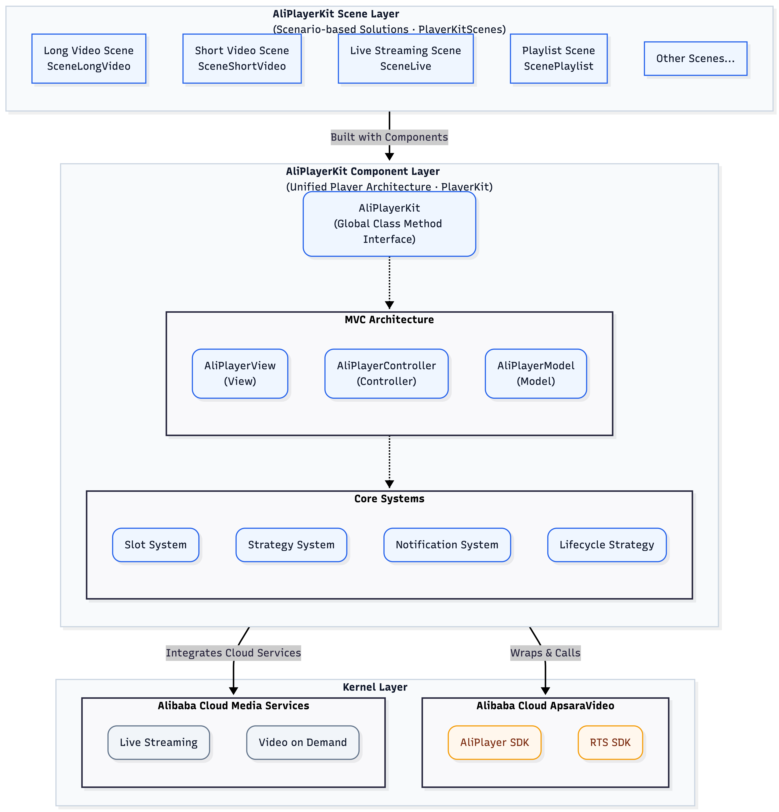
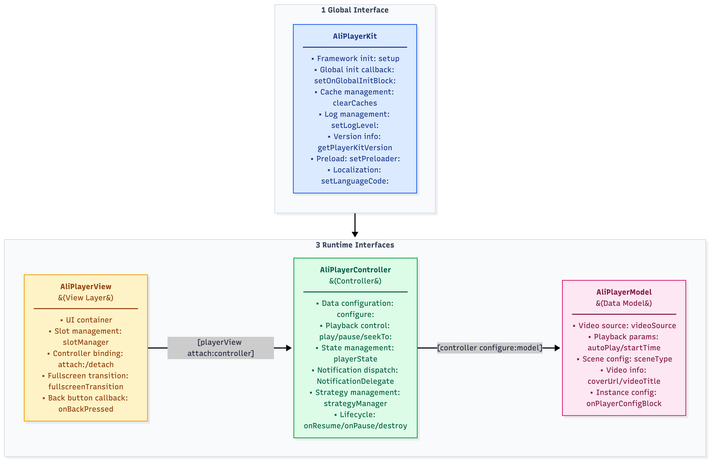
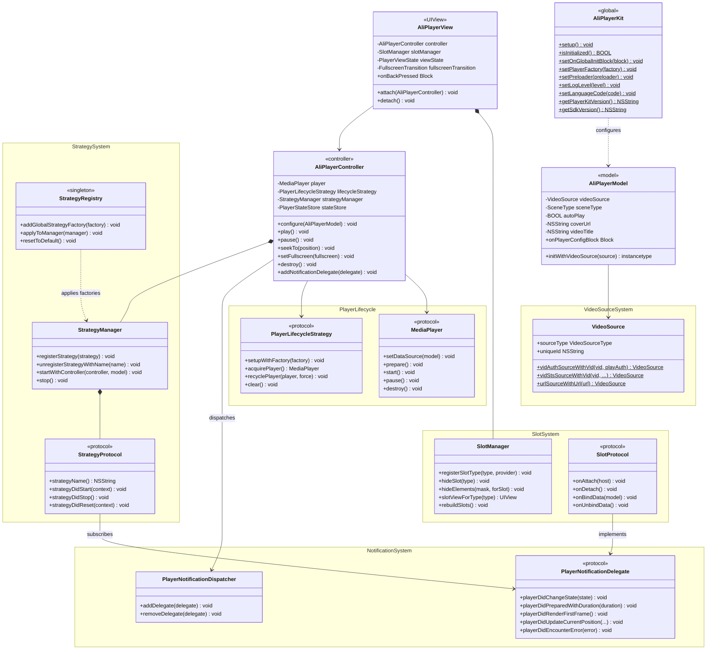
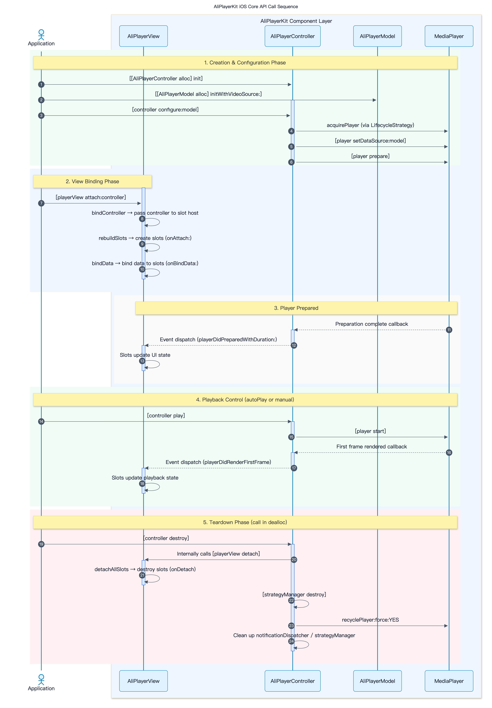

> 📚 **Recommended Reading Path**
>
> **Core Features** → [Integration Guide](./Integration-EN.md) → [Quick Start](./QuickStart-EN.md) → [API Reference](./ApiReference-EN.md)

---

# **AliPlayerKit Core Features**

**AliPlayerKit** is a set of business-oriented **low-code player UI components** and **scenario-based solutions**.

By providing highly encapsulated player capabilities and UI interactions, AliPlayerKit enables customers to rapidly build app playback capabilities with minimal integration effort — without directly calling underlying player APIs or implementing complex player UIs from scratch.

---

## **1. Product Positioning**

### **1.1 Design Goals**

AliPlayerKit is designed to provide developers with an **out-of-the-box yet highly customizable** player UI component layer:

| Design Goal | Description |
|------------|-------------|
| **Low-code Integration** | Complete playback scenarios with minimal code |
| **Multi-scenario Coverage** | Covers VOD, live streaming, short video, AI Education, and more |
| **Reusable Architecture** | Slot + Strategy architecture eliminates redundant player development across teams |
| **Unified Foundation** | Serves as the unified foundation for all player and scenario-based solutions |
| **Cross-platform Alignment** | Shares the same architectural design philosophy with the Android version; interface semantics remain consistent |

### **1.2 Architecture Layers**

Architecturally, **AliPlayerKit sits above the player engine**, providing a unified UI component system and playback scenario abstraction that carries common capabilities across different playback use cases:



| Layer | Positioning | Module Location | Responsibilities |
|-------|------------|-----------------|-----------------|
| **Component Layer** | Player UI Components | `PlayerKit/` | Provides out-of-the-box, configurable player UI components covering basic playback and common interactions. |
| **Scene Layer** | Scenario-based Solutions | `PlayerKitScenes/` | Built around typical scenarios such as short dramas, mid/long-form video, live streaming, and AI Education, providing standardized integration examples that help customers quickly build complete playback capabilities with minimal code. |

---

## **2. Core Architecture**

### **2.1 MVC "3 + 1" Design**

AliPlayerKit adopts a **"3 + 1" core architecture design** to build the player framework:

- **3 Runtime Interfaces**: Following the **MVC architectural pattern**, implementing separation and decoupling of UI presentation, playback control, and data configuration
  - `AliPlayerView`: Player UI container (`UIView` subclass), manages slot layout and rendering layer (`View`)
  - `AliPlayerController`: Playback controller, manages playback state, notification dispatching, and strategy scheduling (`Controller`)
  - `AliPlayerModel`: Data model, encapsulates video source, scene type, auto-play, and other configurations (`Model`)
- **1 Global Interface**: Provides framework initialization and global capability management, serving as the unified entry point for the player framework
  - `AliPlayerKit`: Handles framework initialization and provides global configuration, logging, preloading, and other foundational capabilities

### **2.2 Architecture Diagram**



### **2.3 Component Responsibilities**

| Component | Type | Responsibilities | Lifecycle |
|-----------|------|-----------------|-----------|
| `AliPlayerKit` | Global Entry | Global initialization, configuration management, logging/preloading management, version info | Application-level |
| `AliPlayerView` | View | UI container, slot host, fullscreen transition, back button callback | Page-level |
| `AliPlayerController` | Controller | Playback control, state management, notification dispatching, strategy scheduling | Page-level |
| `AliPlayerModel` | Model | Playback configuration encapsulation (video source, scene type, auto-play, etc.) | Request-level |

### **2.4 Core Interfaces**

Core interfaces required for each player instance:

| Interface | Description |
|-----------|-------------|
| `[[AliPlayerController alloc] init]` | Create controller (using default lifecycle strategy) |
| `[[AliPlayerController alloc] initWithLifecycleStrategy:]` | Create controller (with specified lifecycle strategy) |
| `[[AliPlayerModel alloc] initWithVideoSource:]` | Build data model |
| `[controller configure:model]` | Configure playback data |
| `[playerView attach:controller]` | Bind controller to view |
| `[controller onResume]` / `[controller onPause]` | Lifecycle resume/pause |
| `[playerView detach]` | Unbind view |
| `[controller destroy]` | Destroy controller, release resources |

> **Detailed API Documentation**: For the complete method list and parameter descriptions of each component, see [API Reference](./ApiReference-EN.md).

### **2.5 Core Class Diagram**



### **2.6 Call Sequence**



> **Quick Integration**: For the complete integration steps, see [Quick Start](./QuickStart-EN.md).

---

## **3. Core Features**

### **3.1 Slot System**

The **Slot System** divides the player UI into independent slot components, each responsible for a specific part of the interface — such as the top control bar, bottom progress bar, cover image, etc. Developers can freely compose them like building blocks: use the default UI for quick integration, replace specific components as needed, or fully customize the entire interface.

UI components are completely decoupled from the player core. Customization no longer means modifying source code, and upgrades no longer risk code conflicts. Different playback scenarios can reuse the same slot components, reducing redundant development.

**Built-in Slot Types**:

| Slot Type | Enum Value | Responsibilities |
|-----------|-----------|-----------------|
| `SlotTypePlayerSurface` | 10 | Player rendering view layer |
| `SlotTypeGestureControl` | 20 | Gesture recognition and control layer |
| `SlotTypeLandscapeHint` | 30 | Landscape orientation hint layer |
| `SlotTypeCover` | 40 | Video cover image layer |
| `SlotTypeCenterDisplay` | 50 | Center display layer (loading/volume/brightness) |
| `SlotTypePlayState` | 60 | Playback state indicator layer |
| `SlotTypeTopBar` | 80 | Top navigation bar layer |
| `SlotTypeSeekThumbnail` | 85 | Displays thumbnail preview of target position when dragging the progress bar |
| `SlotTypeBottomBar` | 90 | Bottom control bar layer |
| `SlotTypeSettingMenu` | 100 | Settings menu layer |
| `SlotTypeOptionPanel` | 110 | Option panel layer (playback speed/quality) |
| `SlotTypeChapterPanel` | 115 | Chapter content panel, displays chapter list with seek-to-chapter support |

The slot system supports three levels of visibility control: **Slot-level** (show/hide entire slot), **Scene-level** (controlled by `SceneType`), and **Element-level** (bitmask control of sub-elements within a slot, such as hiding the back button or disabling specific gestures). It also supports registering custom slots via `CustomSlotType`.

See [Slot System](./advanced/SlotSystem-EN.md) for details.

### **3.2 Strategy System**

The **Strategy System** encapsulates player business logic into independent strategy components, each carrying a clearly defined function. Strategies define their lifecycle through the `StrategyProtocol` protocol (`strategyDidStart:` / `strategyDidStop` / `strategyDidReset:`), and are managed uniformly by `StrategyManager`. Each strategy's execution is isolated via `@try/@catch`, ensuring that a single strategy failure does not affect others.

**Built-in Strategies**:

| Strategy | Class Name | Function |
|----------|-----------|----------|
| First Frame Timing | `FirstFrameStrategy` | Measures preparation phase + rendering phase duration, supports delegate callback |
| Stutter Detection | `StutterDetectStrategy` | Tracks stutter count/duration/effective playback time, supports threshold configuration |
| Traffic Protection | `TrafficProtectionStrategy` | Monitors cellular network state changes, detects and notifies |

Through `StrategyRegistry`, you can register global default strategy factories that are automatically loaded into every newly created `AliPlayerController`. Developers can also register or unregister custom strategies at the instance level via `strategyManager` as needed, without modifying the framework core.

See [Strategy System](./advanced/StrategySystem-EN.md) for details.

### **3.3 Notification System**

The **Notification System** uses a **Notification Dispatcher + Delegate** pattern to achieve complete decoupling between components.

On iOS, categorized notification dispatching is implemented through three independent notification protocols:

| Notification Protocol | Responsibilities | Typical Notifications |
|----------------------|-----------------|----------------------|
| `PlayerNotificationDelegate` | Player state and playback notifications | State changes, progress updates, first frame render, errors, fullscreen toggle, quality switch |
| `GestureNotificationDelegate` | Gesture interaction notifications | Single tap, long press speed-up, brightness/volume drag |
| `SlotActionNotificationDelegate` | Inter-slot action notifications | Settings menu toggle, speed panel/quality panel display |

UI components subscribe to notifications of interest through Delegate protocols without holding controller references; the controller multicasts state changes through the Dispatcher without caring who is listening. Based on instance-level notification isolation, each Controller holds an independent Dispatcher instance, ensuring notifications from different player instances do not interfere with each other.

> **Cross-platform Difference**: Android uses a global event bus (`PlayerEventBus`) + `playerId` isolation publish-subscribe pattern. iOS uses an instance-level Dispatcher + Delegate pattern, which better aligns with Cocoa programming conventions. Both platforms are functionally equivalent, differing only in communication mechanism.

See [Notification System](./advanced/NotificationSystem-EN.md) for details.

### **3.4 Player Lifecycle Strategy**

The **Player Lifecycle Strategy** provides unified management of player instance creation, reuse, recycling, and destruction through the `PlayerLifecycleStrategy` protocol.

Four built-in strategies:

| Strategy | Class Name | Behavior | Use Case |
|----------|-----------|----------|----------|
| **Default** | `DefaultLifecycleStrategy` | Creates a new instance on each acquisition, destroys on recycling | General scenarios (default) |
| **Singleton** | `SingletonLifecycleStrategy` | Single global instance, stays alive on recycling | Single-player scenarios, list playback |
| **Reuse Pool** | `ReusePoolLifecycleStrategy` | Maintains an idle player pool, prioritizes reuse | Short video list scrolling scenarios |
| **ID Pool** | `IdScopedPoolLifecycleStrategy` | Maintains independent instances per `uniqueId`, LRU eviction | Preloading scenarios |

Developers do not need to worry about underlying implementation details — simply choose the appropriate strategy to achieve the best balance between performance and resources. For example, using the ReusePool strategy for short video list scenarios can significantly improve scrolling smoothness and first-frame speed.

See [Player Lifecycle Strategy](./advanced/PlayerLifecycleStrategy-EN.md) for details.

### **3.5 Logging System**

The **Logging System** provides a unified log center `LogHub`, supporting filtered output across six levels (Verbose / Debug / Info / Warn / Error / None). Every critical node during player runtime is traceable, providing support for troubleshooting and performance analysis.

Through the `LogObserver` protocol, you can extend log destinations — writing logs to files or reporting to servers for production issue investigation. Enable Verbose during development for debugging assistance, and set to Error in production for streamlined output.

```objc
// Set log level
[AliPlayerKit setLogLevel:LogLevelVerbose];
// Enable/disable console logging
[AliPlayerKit enableConsoleLog:YES];
```

See [Logging System](./advanced/LogSystem-EN.md) for details.

### **3.6 Multi-Video Source Support**

AliPlayerKit encapsulates video source information through the `VideoSource` model, supporting three integration methods. **VidAuth is the recommended approach**:

| Source Type | Creation Method | Use Case |
|------------|----------------|----------|
| VidAuth Source | `[VideoSource vidAuthSourceWithVid:playAuth:]` | Recommended for Alibaba Cloud VOD (Recommended) |
| VidSts Source | `[VideoSource vidStsSourceWithVid:accessKeyId:accessKeySecret:securityToken:region:]` | Alibaba Cloud STS temporary credentials |
| URL Source | `[VideoSource urlSourceWithUrl:]` | Live streaming or simple scenarios |

> **Cross-platform Alignment**: Android creates video sources through the `VideoSourceFactory` factory class, while iOS uses `VideoSource` class methods. The three source types are identical across all platforms.

See [Multi-Video Source Support](./advanced/VideoSource-EN.md) for details.

### **3.7 Custom Configuration**

**Custom Configuration** provides a dual-level configuration mechanism, allowing developers to inject custom SDK configurations at key moments without modifying framework source code for global or instance-level fine-tuning.

| Level | Registration Method | Trigger Timing | Typical Scenarios |
|-------|-------------------|----------------|-------------------|
| Global | `[AliPlayerKit setOnGlobalInitBlock:]` | After `setup` completes (once only) | setOption, global log level |
| Instance | `model.onPlayerConfigBlock` | During `configure:` before `prepare` | setConfig (buffering/Referer), setOption |

```objc
// Global configuration
[AliPlayerKit setOnGlobalInitBlock:^{
    // Executed once after setup
}];

// Instance configuration
model.onPlayerConfigBlock = ^(id<MediaPlayer> player) {
    // Executed before prepare, with access to the underlying player instance
};
```

See [Custom Configuration](./advanced/CustomConfig-EN.md) for details.

### **3.8 Localization System**

The **Localization System** supports multi-language switching for all UI text within the SDK, with built-in Simplified Chinese (`zh-Hans`) and English (`en`).

| Capability | Interface | Description |
|-----------|-----------|-------------|
| Manual language switch | `[AliPlayerKit setLanguageCode:]` | Specify language code, overriding system language |
| Follow system | `[AliPlayerKit resetLocaleToSystemLanguage]` | Restore to follow system preferred language |
| Custom translation | `[AliPlayerKit setLocaleProvider:]` | Inject `LocaleProvider`, takes highest priority |

Through the `LocaleProvider` protocol, the host App can override any text — when the Provider returns `nil`, it automatically falls back to SDK built-in translations.

See [Localization System](./advanced/Locale-EN.md) for details.

### **3.9 Fullscreen and Screen Recording Prevention (iOS-specific)**

The **Fullscreen Transition System** abstracts fullscreen enter/exit behavior through the `FullscreenTransition` protocol. The default implementation `DefaultFullscreenTransition` uses an independent Window rotation approach. You can inject a custom implementation via `playerView.fullscreenTransition` to accommodate special business scenarios.

**Screen Recording Prevention** (iOS-specific): Enabled via `AliPlayerModel.disableScreenshot = YES`. When enabled, the video rendering view is embedded in a secure container — the video content automatically turns black during screenshots or screen recording, while UI controls remain unaffected.

### **3.10 Preloading System**

The **Preloading System** encapsulates the player SDK's global preloading capabilities through the `PlayerPreloader` protocol, supporting add, cancel, pause, and resume preloading tasks. A built-in `DefaultPlayerPreloader` implementation is provided, and custom implementations can be injected via `[AliPlayerKit setPreloader:]`.

### **3.11 VID All-in-One Playback Experience**

Leveraging the synergy between AliPlayerKit and Alibaba Cloud VOD, the business layer only needs to pass in a video VID to automatically obtain playback resources along with associated media assets such as cover image, thumbnail, and video title — simplifying playback integration.

After the player reaches the prepared state, AliPlayerKit automatically extracts the following media information from the cloud MediaInfo and distributes it to the corresponding Slots via the notification system:

| Media Info | Notification Callback | Consumer Slot | Description |
|-----------|----------------------|---------------|-------------|
| Cover URL | `playerDidReadyCoverUrl:` | CoverSlot | Displays cover image before playback |
| Video Title | `playerDidReadyVideoTitle:` | TopBarSlot | Displays video title in the top bar |
| Thumbnail URL | `playerDidReadyThumbnailUrl:` | SeekThumbnailSlot | Displays thumbnail when dragging progress bar |

**Priority Rule:** Values manually configured via `AliPlayerModel` (`coverUrl` / `thumbnailUrl` / `videoTitle`) take precedence over MediaInfo auto-extraction. MediaInfo values are only used when no manual configuration is provided.

> 💡 This feature requires Alibaba Cloud Player SDK version ≥ 7.16.0.

### **3.12 Video Segmentation**

Intelligently splits long videos into multiple chapter segments based on content structure, helping users quickly locate key content and improving video learning and comprehension efficiency. Chapter data is generated by the AI content understanding service after analyzing the video, and injected via `AliPlayerModel.chapters`.

| Component | Capability |
|-----------|------------|
| `ChapterInfo` data model | Describes the time interval (`[startMs, endMs)`) and display info (title, thumbnail) of each segment |
| `BottomBarSlot` chapter markers | Intuitively displays content structure split points on the progress bar |
| `ChapterPanelSlot` | Fullscreen right-side slide-in structured content navigation panel with tap-to-seek to target segment |

**Scene Restriction:** Only takes effect under the `SceneTypeAIVod` scene.

### **3.13 Scene Types**

The `SceneType` enum defines playback scenarios, affecting slot visibility configuration and UI behavior differences:

| Enum Value | Scenario | Description |
|-----------|----------|-------------|
| `SceneTypeVOD` | Video on Demand | Default scenario, full control bar |
| `SceneTypeLive` | Live Streaming | Hides progress bar and other VOD elements |
| `SceneTypeVideoList` | Video List / Short Video Feed | Simplified UI |
| `SceneTypeRestricted` | Restricted Playback | Minimized interaction |
| `SceneTypeMinimal` | Minimal Player Page | Fewest UI elements |
| `SceneTypeAIVod` | AI Video on Demand | AI Video-on-Demand scene (chapter segmentation and AI content analysis) |

See [Scene Types](./advanced/SceneType-EN.md) for details.

---

With the overview above, you now have a solid understanding of AliPlayerKit's core components and overall architectural design.

Next, you can refer to **[Integration Guide](./Integration-EN.md)** to integrate AliPlayerKit into your project.
