> 📚 **推荐阅读路径**
>
> **核心能力** → [集成准备](./Integration.md) → [快速开始](./QuickStart.md) → [API 参考](./ApiReference.md)

---

# **AliPlayerKit 核心能力**

**AliPlayerKit** 是一套面向业务的 **低代码播放器 UI 组件** 与 **场景化解决方案**。

通过对播放器能力和 UI 交互的高度封装，AliPlayerKit 帮助客户以极低的接入成本快速完成 App 播放能力建设，无需直接调用底层播放器 API，也无需自行实现复杂的播放器 UI。

---

## **1. 产品定位**

### **1.1 设计目标**

AliPlayerKit 的设计目标是为开发者提供一套**开箱即用且高度可定制**的播放器 UI 组件层：

| 设计目标 | 说明 |
|---------|------|
| **低代码接入** | 通过少量代码即可接入完整播放场景 |
| **多场景覆盖** | 覆盖点播、直播、短视频等多种播放场景 |
| **可复用架构** | 通过插槽 + 策略架构，避免各业务重复建设播放器能力 |
| **统一基座** | 作为所有播放器解决方案和场景化解决方案的统一基座 |
| **跨平台对齐** | 与 Android 版本共享相同架构设计理念，接口语义保持一致 |

### **1.2 架构层级**

在架构层级上，**AliPlayerKit 位于播放器内核之上**，通过统一的 UI 组件体系与播放场景抽象，承载不同播放业务的共性能力：

```text
┌─────────────────────────────────────────────────────────┐
│                    应用业务层 (App)                       │
│          业务逻辑、页面路由、数据获取                       │
├─────────────────────────────────────────────────────────┤
│                  场景层 (PlayerKitScenes)                 │
│  ┌────────────┐ ┌────────────┐ ┌──────────┐ ┌────────┐ │
│  │ 长视频场景  │ │ 短视频场景  │ │ 直播场景  │ │播放列表 │ │
│  └────────────┘ └────────────┘ └──────────┘ └────────┘ │
├─────────────────────────────────────────────────────────┤
│                 组件层 (PlayerKit)                        │
│    MVC 核心 + 插槽系统 + 通知系统 + 策略系统 + ...        │
├─────────────────────────────────────────────────────────┤
│              底层播放器 SDK (AliPlayer iOS)               │
│              解码 / 渲染 / 网络 / DRM                     │
└─────────────────────────────────────────────────────────┘
```

| 层级 | 定位 | 模块位置 | 职责 |
|------|------|---------|------|
| **组件层** | 播放器 UI 组件 | `PlayerKit/` | 提供开箱即用、可配置的播放器 UI 组件，覆盖基础播放与常见交互能力。 |
| **场景层** | 场景化解决方案 | `PlayerKitScenes/` | 围绕短剧、中长视频、直播等典型场景，提供标准化接入示例，帮助客户以少量代码快速搭建完整播放能力。 |

---

## **2. 核心架构**

### **2.1 MVC「3 + 1」设计**

AliPlayerKit 采用 **「3 + 1」核心架构设计** 构建播放器框架：

- **3 个运行时接口**：遵循 **MVC 架构模式**，实现 UI 展示、播放控制与数据配置的职责分层与解耦
  - `AliPlayerView`：播放器 UI 容器（`UIView` 子类），管理插槽布局与渲染层（`View`）
  - `AliPlayerController`：播放控制器，管理播放状态、通知分发与策略调度（`Controller`）
  - `AliPlayerModel`：数据模型，封装视频源、场景类型、自动播放等配置（`Model`）
- **1 个全局接口**：提供框架初始化与全局能力管理，是播放器框架的统一入口
  - `AliPlayerKit`：负责框架初始化，并提供全局配置、日志管理、预加载等基础能力

### **2.2 架构关系图**

```text
┌──────────────────────────────────────────────────────────┐
│                    UIViewController                        │
│                                                           │
│  ┌────────────────────────────────────────────────────┐  │
│  │             AliPlayerView (UIView)                  │  │
│  │  ┌──────────────────────────────────────────────┐  │  │
│  │  │          SlotHostView (UIView)                │  │  │
│  │  │  ┌────────┐ ┌────────┐ ┌──────────┐         │  │  │
│  │  │  │TopBar  │ │Surface │ │BottomBar │  ...     │  │  │
│  │  │  └────────┘ └────────┘ └──────────┘         │  │  │
│  │  └──────────────────────────────────────────────┘  │  │
│  └────────────────────────────────────────────────────┘  │
│                        │ attach/detach                     │
│  ┌────────────────────────────────────────────────────┐  │
│  │           AliPlayerController                       │  │
│  │  ┌──────────────┐  ┌───────────────────────────┐   │  │
│  │  │ MediaPlayer  │  │    StrategyManager        │   │  │
│  │  │  (Protocol)  │  │  ┌────────┐ ┌────────┐   │   │  │
│  │  │              │  │  │Strategy│ │Strategy│   │   │  │
│  │  └──────────────┘  │  └────────┘ └────────┘   │   │  │
│  │                     └───────────────────────────┘   │  │
│  └────────────────────────────────────────────────────┘  │
│                        │ configure                         │
│  ┌────────────────────────────────────────────────────┐  │
│  │              AliPlayerModel                         │  │
│  │  videoSource / sceneType / autoPlay / coverUrl      │  │
│  └────────────────────────────────────────────────────┘  │
└──────────────────────────────────────────────────────────┘

┌──────────────────────────────────────────────────────────┐
│              AliPlayerKit (全局类方法接口)                   │
│  setup / logger / preloader / config / version            │
└──────────────────────────────────────────────────────────┘
```

### **2.3 组件职责**

| 组件 | 类型 | 职责 | 生命周期 |
|-----|------|------|---------|
| `AliPlayerKit` | 全局入口 | 全局初始化、配置管理、日志/预加载管理、版本信息 | 应用级 |
| `AliPlayerView` | View | UI 容器、插槽宿主、全屏过渡、返回键回调 | 页面级 |
| `AliPlayerController` | Controller | 播放控制、状态管理、通知分发、策略调度 | 页面级 |
| `AliPlayerModel` | Model | 播放配置封装（视频源、场景类型、自动播放等） | 请求级 |

### **2.4 核心接口**

每个播放器实例需要调用的核心接口：

| 接口 | 说明 |
|-----|------|
| `[[AliPlayerController alloc] init]` | 创建控制器（使用默认生命周期策略） |
| `[[AliPlayerController alloc] initWithLifecycleStrategy:]` | 创建控制器（指定生命周期策略） |
| `[[AliPlayerModel alloc] initWithVideoSource:]` | 构建数据模型 |
| `[controller configure:model]` | 配置播放数据 |
| `[playerView attach:controller]` | 绑定控制器与视图 |
| `[controller onResume]` / `[controller onPause]` | 生命周期恢复/暂停 |
| `[playerView detach]` | 解绑视图 |
| `[controller destroy]` | 销毁控制器，释放资源 |

> **详细 API 说明**：各组件的完整方法列表和参数说明，请参阅 [API 参考](./ApiReference.md)。

### **2.5 核心类图**

```mermaid
classDiagram

    %% =========================
    %% Core Architecture (3+1)
    %% =========================
    class AliPlayerKit {
        <<global>>
        +setup()$ void
        +isInitialized()$ BOOL
        +setOnGlobalInitBlock(block)$ void
        +setPlayerFactory(factory)$ void
        +setPreloader(preloader)$ void
        +setLogLevel(level)$ void
        +setLanguageCode(code)$ void
        +getPlayerKitVersion()$ NSString
        +getSdkVersion()$ NSString
    }

    class AliPlayerView {
        <<UIView>>
        -AliPlayerController controller
        -SlotManager slotManager
        -PlayerViewState viewState
        -FullscreenTransition fullscreenTransition
        +attach(AliPlayerController) void
        +detach() void
        +onBackPressed Block
    }

    class AliPlayerController {
        <<controller>>
        -MediaPlayer player
        -PlayerLifecycleStrategy lifecycleStrategy
        -StrategyManager strategyManager
        -PlayerStateStore stateStore
        +configure(AliPlayerModel) void
        +play() void
        +pause() void
        +seekTo(position) void
        +setFullscreen(fullscreen) void
        +destroy() void
        +addNotificationDelegate(delegate) void
    }

    class AliPlayerModel {
        <<model>>
        -VideoSource videoSource
        -SceneType sceneType
        -BOOL autoPlay
        -NSString coverUrl
        -NSString videoTitle
        +initWithVideoSource(source) instancetype
        +onPlayerConfigBlock Block
    }

    %% =========================
    %% Slot System
    %% =========================
    namespace SlotSystem {
        class SlotManager {
            +registerSlotType(type, provider) void
            +hideSlot(type) void
            +hideElements(mask, forSlot) void
            +slotViewForType(type) UIView
            +rebuildSlots() void
        }

        class SlotProtocol {
            <<protocol>>
            +onAttach(host) void
            +onDetach() void
            +onBindData(model) void
            +onUnbindData() void
        }
    }

    %% =========================
    %% Strategy System
    %% =========================
    namespace StrategySystem {
        class StrategyManager {
            +registerStrategy(strategy) void
            +unregisterStrategyWithName(name) void
            +startWithController(controller, model) void
            +stop() void
        }

        class StrategyProtocol {
            <<protocol>>
            +strategyName() NSString
            +strategyDidStart(context) void
            +strategyDidStop() void
            +strategyDidReset(context) void
        }

        class StrategyRegistry {
            <<singleton>>
            +addGlobalStrategyFactory(factory) void
            +applyToManager(manager) void
            +resetToDefault() void
        }
    }

    %% =========================
    %% Event System (Delegate-based)
    %% =========================
    namespace NotificationSystem {
        class PlayerNotificationDelegate {
            <<protocol>>
            +playerDidChangeState(state) void
            +playerDidPreparedWithDuration(duration) void
            +playerDidRenderFirstFrame() void
            +playerDidUpdateCurrentPosition(...) void
            +playerDidEncounterError(error) void
        }

        class PlayerNotificationDispatcher {
            +addDelegate(delegate) void
            +removeDelegate(delegate) void
        }
    }

    %% =========================
    %% Player Lifecycle
    %% =========================
    namespace PlayerLifecycle {
        class MediaPlayer {
            <<protocol>>
            +setDataSource(model) void
            +prepare() void
            +start() void
            +pause() void
            +destroy() void
        }

        class PlayerLifecycleStrategy {
            <<protocol>>
            +setupWithFactory(factory) void
            +acquirePlayer() MediaPlayer
            +recyclePlayer(player, force) void
            +clear() void
        }
    }

    %% =========================
    %% Video Source
    %% =========================
    namespace VideoSourceSystem {
        class VideoSource {
            +sourceType VideoSourceType
            +uniqueId NSString
            +vidAuthSourceWithVid(vid, playAuth)$ VideoSource
            +vidStsSourceWithVid(vid, ...)$ VideoSource
            +urlSourceWithUrl(url)$ VideoSource
        }
    }

    %% =========================
    %% Relations
    %% =========================
    AliPlayerKit ..> AliPlayerModel : configures
    AliPlayerView *-- SlotManager
    AliPlayerView --> AliPlayerController
    AliPlayerController *-- StrategyManager
    AliPlayerController --> MediaPlayer
    AliPlayerController --> PlayerLifecycleStrategy
    AliPlayerController --> PlayerNotificationDispatcher : dispatches
    AliPlayerModel --> VideoSource
    SlotProtocol --> PlayerNotificationDelegate : implements
    StrategyProtocol --> PlayerNotificationDelegate : subscribes
    StrategyManager *-- StrategyProtocol
    StrategyRegistry ..> StrategyManager : applies factories
```



### **2.6 调用时序**

// TODO keria
> **快速接入**：完整接入步骤请参阅 [快速开始](./QuickStart.md)。

---

## **3. 核心能力**

### **3.1 插槽系统**

**插槽系统** 将播放器 UI 拆分为独立的插槽组件，每个插槽负责界面的一部分功能，如顶部控制栏、底部进度条、封面图等。开发者可以像搭积木一样自由组合：使用默认界面快速接入，或按需替换特定组件，甚至完全自定义整个界面。

UI 组件与播放器核心彻底解耦，定制不再意味着修改源码，升级也无需担心代码冲突。不同播放场景可以复用相同的插槽组件，减少重复开发。

**内置插槽类型**：

| 插槽类型 | 枚举值 | 职责 |
|---------|-------|------|
| `SlotTypePlayerSurface` | 10 | 播放器渲染视图层 |
| `SlotTypeGestureControl` | 20 | 手势识别和控制层 |
| `SlotTypeLandscapeHint` | 30 | 横屏提示层 |
| `SlotTypeCover` | 40 | 视频封面图层 |
| `SlotTypeCenterDisplay` | 50 | 中心展示层（加载/音量/亮度） |
| `SlotTypePlayState` | 60 | 播放状态指示层 |
| `SlotTypeTopBar` | 80 | 顶部导航栏层 |
| `SlotTypeBottomBar` | 90 | 底部控制栏层 |
| `SlotTypeSettingMenu` | 100 | 设置菜单层 |
| `SlotTypeOptionPanel` | 110 | 选项面板层（倍速/清晰度） |

插槽系统支持三个层级的可见性控制：**插槽级**（整体隐藏/显示）、**场景级**（按 `SceneType` 控制）、**元素级**（位掩码控制插槽内部子元素，如隐藏返回按钮或禁用特定手势）。还支持通过 `CustomSlotType` 注册自定义插槽。

详见 [插槽系统](./advanced/SlotSystem.md)。

### **3.2 策略系统**

**策略系统** 将播放器的业务逻辑封装为独立的策略组件，每个策略承载一个明确的功能。策略通过 `StrategyProtocol` 协议定义生命周期（`strategyDidStart:` / `strategyDidStop` / `strategyDidReset:`），通过 `StrategyManager` 统一管理，每个策略的执行通过 `@try/@catch` 隔离，单个策略异常不影响其他策略。

**内置策略**：

| 策略 | 类名 | 功能 |
|------|------|------|
| 首帧耗时监测 | `FirstFrameStrategy` | 测量准备阶段 + 渲染阶段耗时，支持 delegate 回调 |
| 卡顿检测 | `StutterDetectStrategy` | 统计卡顿次数/时长/有效播放时长，支持阈值配置 |
| 流量保护 | `TrafficProtectionStrategy` | 监控蜂窝网络状态变化，检测并通知 |

通过 `StrategyRegistry` 可注册全局默认策略工厂，每个新创建的 `AliPlayerController` 自动装载。业务方也可以在实例级通过 `strategyManager` 按需注册或注销自定义策略，无需侵入框架核心。

详见 [策略系统](./advanced/StrategySystem.md)。

### **3.3 通知系统**

**通知系统** 采用 **Notification Dispatcher + Delegate** 模式实现组件间的完全解耦。

iOS 端通过三组独立的通知协议实现分类通知分发：

| 通知协议 | 职责 | 典型通知 |
|---------|------|---------|
| `PlayerNotificationDelegate` | 播放器状态与播放通知 | 状态变化、进度更新、首帧渲染、错误、全屏切换、清晰度切换 |
| `GestureNotificationDelegate` | 手势交互通知 | 单击、长按倍速、亮度/音量拖拽 |
| `SlotActionNotificationDelegate` | 插槽间操作通知 | 设置菜单切换、倍速面板/画质面板显示 |

UI 组件通过 Delegate 协议订阅关心的通知，无需持有控制器引用；控制器通过 Dispatcher 多播分发状态变化，无需关心谁在监听。基于实例粒度的通知隔离，每个 Controller 持有独立的 Dispatcher 实例，不同播放器实例的通知互不干扰。

> **跨平台差异**：Android 端采用全局事件总线（`PlayerEventBus`）+ `playerId` 隔离的发布-订阅模式。iOS 端采用实例级 Dispatcher + Delegate 模式，更符合 Cocoa 编程范式。两端功能等价，仅通信机制不同。

详见 [通知系统](./advanced/NotificationSystem.md)。

### **3.4 播放器生命周期策略**

**播放器生命周期策略** 通过 `PlayerLifecycleStrategy` 协议对播放器实例的创建、复用、回收与销毁进行统一管理。

内置四种策略：

| 策略 | 类名 | 行为 | 适用场景 |
|------|------|------|---------|
| **默认** | `DefaultLifecycleStrategy` | 每次获取创建新实例，回收即销毁 | 通用场景（默认） |
| **单例** | `SingletonLifecycleStrategy` | 全局唯一实例，回收时保持存活 | 单播放器场景、列表播放 |
| **复用池** | `ReusePoolLifecycleStrategy` | 维护空闲播放器池，优先复用 | 短视频列表滑动场景 |
| **ID 池** | `IdScopedPoolLifecycleStrategy` | 为每个 `uniqueId` 维护独立实例，LRU 淘汰 | 预加载场景 |

开发者无需关心底层实现细节，只需选择合适的策略，即可在性能与资源之间取得最佳平衡。例如，短视频列表场景下使用 ReusePool 策略复用实例，可显著提升滑动流畅度和首帧速度。

详见 [播放器生命周期策略](./advanced/PlayerLifecycleStrategy.md)。

### **3.5 日志系统**

**日志系统** 提供统一的日志中心 `LogHub`，支持六个级别（Verbose / Debug / Info / Warn / Error / None）的过滤输出。播放器运行时的每一个关键节点都有迹可循，为问题定位和性能分析提供支持。

通过 `LogObserver` 协议扩展日志去向——可将日志写入文件或上报服务器，便于线上问题排查。开发阶段开启 Verbose 辅助调试，生产环境设为 Error 精简输出。

```objc
// 设置日志级别
[AliPlayerKit setLogLevel:LogLevelVerbose];
// 启用/禁用控制台日志
[AliPlayerKit enableConsoleLog:YES];
```

详见 [日志系统](./advanced/LogSystem.md)。

### **3.6 多视频源支持**

AliPlayerKit 通过 `VideoSource` 模型封装视频源信息，支持三种接入方式，**推荐使用 VidAuth 方式**：

| 源类型 | 创建方法 | 适用场景 |
|-------|---------|----------|
| VidAuth 源 | `[VideoSource vidAuthSourceWithVid:playAuth:]` | 阿里云点播推荐方式（推荐） |
| VidSts 源 | `[VideoSource vidStsSourceWithVid:accessKeyId:accessKeySecret:securityToken:region:]` | 阿里云 STS 临时凭证方式 |
| URL 源 | `[VideoSource urlSourceWithUrl:]` | 直播或简单场景 |

> **跨平台对齐**：Android 端通过 `VideoSourceFactory` 工厂类创建视频源，iOS 端通过 `VideoSource` 类方法创建。三种源类型在各平台完全一致。

详见 [多视频源支持](./advanced/VideoSource.md)。

### **3.7 自定义配置**

**自定义配置** 提供双层级配置机制，允许开发者在关键时机注入自定义 SDK 配置，无需修改框架源码即可完成全局或实例级的精细调参。

| 层级 | 注册方式 | 触发时机 | 典型场景 |
|------|---------|---------|----------|
| 全局 | `[AliPlayerKit setOnGlobalInitBlock:]` | `setup` 完成后（仅一次） | setOption、全局日志级别 |
| 实例 | `model.onPlayerConfigBlock` | `configure:` 中 `prepare` 前 | setConfig（缓冲/Referer）、setOption |

```objc
// 全局配置
[AliPlayerKit setOnGlobalInitBlock:^{
    // 在 setup 后执行一次
}];

// 实例配置
model.onPlayerConfigBlock = ^(id<MediaPlayer> player) {
    // 在 prepare 前执行，可访问底层播放器实例
};
```

详见 [自定义配置](./advanced/CustomConfig.md)。

### **3.8 本地化系统**

**本地化系统** 支持 SDK 内部所有 UI 文本的多语言切换，内置简体中文（`zh-Hans`）和英语（`en`）。

| 能力 | 接口 | 说明 |
|------|------|------|
| 手动切语言 | `[AliPlayerKit setLanguageCode:]` | 指定语言代码，覆盖系统语言 |
| 跟随系统 | `[AliPlayerKit resetLocaleToSystemLanguage]` | 恢复跟随系统首选语言 |
| 自定义翻译 | `[AliPlayerKit setLocaleProvider:]` | 注入 `LocaleProvider`，优先级最高 |

通过 `LocaleProvider` 协议，宿主 App 可覆盖任意文案——Provider 返回 `nil` 时自动降级到 SDK 内置翻译。

详见 [本地化系统](./advanced/Locale.md)。

### **3.9 全屏与防录屏（iOS 特有）**

**全屏过渡系统** 通过 `FullscreenTransition` 协议抽象全屏进入/退出行为。默认实现 `DefaultFullscreenTransition` 采用独立 Window 旋转方案。可通过 `playerView.fullscreenTransition` 注入自定义实现以适配特殊业务场景。

**防录屏能力**（iOS 特有）：通过 `AliPlayerModel.disableScreenshot = YES` 启用。启用后视频渲染视图嵌入安全容器，截屏或录屏时视频画面自动变黑，UI 控件不受影响。

### **3.10 预加载系统**

**预加载系统** 通过 `PlayerPreloader` 协议封装播放器 SDK 的全局预加载能力，支持添加、取消、暂停和恢复预加载任务。内置 `DefaultPlayerPreloader` 实现，也可通过 `[AliPlayerKit setPreloader:]` 注入自定义实现。

### **3.11 场景类型**

`SceneType` 枚举定义播放场景，影响插槽可见性配置和 UI 行为差异：

| 枚举值 | 场景 | 说明 |
|-------|------|------|
| `SceneTypeVOD` | 视频点播 | 默认场景，完整控制栏 |
| `SceneTypeLive` | 直播 | 隐藏进度条等点播元素 |
| `SceneTypeVideoList` | 视频列表/短视频流 | 精简 UI |
| `SceneTypeRestricted` | 受限播放 | 最小化交互 |
| `SceneTypeMinimal` | 极简播放页 | 最少 UI 元素 |

详见 [场景类型](./advanced/SceneType.md)。

---

通过以上介绍，您已经了解了 AliPlayerKit 的核心组件和整体架构设计。

接下来，您可以参考 **[集成准备](./Integration.md)**，将 AliPlayerKit 集成到您的项目中。
