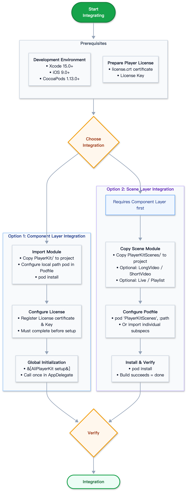

> 📚 **Recommended Reading Path**
>
> [Core Features](./CoreFeatures-EN.md) → **Integration Guide** → [Quick Start](./QuickStart-EN.md) → [API Reference](./ApiReference-EN.md)

---

# **AliPlayerKit Integration Guide**

This document describes the integration steps and prerequisites for AliPlayerKit on iOS, helping you integrate AliPlayerKit into your iOS project.

---

## **1. Integration Options Overview**

AliPlayerKit adopts a layered architecture design, offering two integration options based on integration depth:

| Integration Option | Module | Description | Use Case |
|---------|------|------|---------|
| **Option 1: Component Layer** | `PlayerKit` | Core player UI components providing MVC-architecture player views, controllers, and data models | Need custom player UI or flexible control over playback behavior |
| **Option 2: Scene Layer** | `PlayerKitScenes` | Standard playback scene solutions built on top of the component layer | Quickly implement standard scenarios such as long-form video, short video, live streaming, and playlist playback |

> **Note**: The scene layer depends on the component layer. If you choose scene layer integration, you must complete the component layer integration first.



---

## **2. Prerequisites**

### **2.1 Development Environment Requirements**

| Item | Minimum Requirement | Notes |
|------|---------|------|
| iOS Deployment Target | 9.0+ | Minimum version declared in podspec |
| Xcode | 15.0+ | Latest stable version recommended |
| CocoaPods | 1.13.0+ | Dependency management tool |
| Language | Objective-C | Swift projects can call via bridging |
| Architecture | arm64 | Physical device execution |

> **Swift Project Integration**: PlayerKit is developed in Objective-C. For Swift projects, refer to the [Swift-Call-OC-Example](https://github.com/MediaBox-Demos/AliPlayer-iOS/tree/master/Swift-Call-OC-Example) to integrate and use PlayerKit.

### **2.2 License Preparation**

The Player SDK requires a valid License to function properly.

- You have obtained the ApsaraVideo **License certificate** (`license.crt`) and **License Key** for the player
- For detailed steps, see [Obtain an ApsaraVideo Player SDK license](https://www.alibabacloud.com/help/en/vod/developer-reference/obtain-the-player-sdk-license)

> **Note**: Failure to properly configure the License will cause the player to malfunction, resulting in issues such as black screen during playback. This is the most common integration issue.

---

## **3. Option 1: Component Layer Integration**

The `PlayerKit` module provides out-of-the-box, configurable player UI components and is the core of the entire AliPlayerKit.

### **Step 1: Copy the Module to Your Project**

Copy the `PlayerKit/` directory from this repository into your project directory (at the same level as your `Podfile` or in an appropriate subdirectory).

```
YourProject/
├── YourApp/
├── PlayerKit/                  # ← Copy this directory
│   ├── PlayerKit.podspec
│   ├── Source/
│   └── Resources/
└── Podfile
```

### **Step 2: Configure Podfile**

Reference `PlayerKit` via local path in your `Podfile`:

```ruby
platform :ios, '9.0'

target 'YourApp' do
  use_frameworks!

  # Core component (required, referenced via local path)
  pod 'PlayerKit', :path => './PlayerKit'

  # Underlying player SDK (required)
  pod 'AliPlayerSDK_iOS', '~> 7.15.0'

  # Live RTS ultra-low latency (optional, only needed for live streaming)
  # pod 'AliPlayerSDK_iOS_ARTC', '~> 7.15.0'
  # pod 'RtsSDK', '~> 7.12.0'
end
```

> **Dependency Note**: `PlayerKit.podspec` internally declares dependencies on `AliPlayerSDK_iOS` and `SDWebImage`, which will be automatically fetched during `pod install`. `AliPlayerSDK_iOS` provides video decoding and rendering capabilities, while `SDWebImage` is used for cover image loading. If your project already includes SDWebImage, please ensure version compatibility.

### **Step 3: Install Dependencies**

```bash
pod install
open YourApp.xcworkspace
```

> **Note**: After using CocoaPods, open the project via `.xcworkspace`, not `.xcodeproj`.

### **Step 4: Configure License**

The Player SDK requires a valid License to function properly. Please refer to [Integrate a license](https://www.alibabacloud.com/help/en/vod/developer-reference/access-to-license) to configure the License.

> **Note**: Failure to properly configure the License will cause the player to malfunction, resulting in issues such as black screen during playback.

### **Step 5: Global Initialization**

Complete framework initialization in `AppDelegate` (only needs to be called once during the entire application lifecycle):

* **Objective-C**:

```objc
#import <PlayerKit/AliPlayerKit.h>

- (BOOL)application:(UIApplication *)application didFinishLaunchingWithOptions:(NSDictionary *)launchOptions {
    // (Optional) Global SDK configuration, such as setOption, etc.
    // [AliPlayerKit setOnGlobalInitBlock:^{
    //     // Global configuration executed only once after setup
    // }];

    // Initialize AliPlayerKit
    [AliPlayerKit setup];

    return YES;
}
```

* **Swift**:

```swift
import AliPlayerKit

func application(_ application: UIApplication, didFinishLaunchingWithOptions launchOptions: [UIApplication.LaunchOptionsKey: Any]?) -> Bool {
    // (Optional) Global SDK configuration
    // AliPlayerKit.setOnGlobalInitBlock {
    //     // Global configuration executed only once after setup
    // }

    // Initialize AliPlayerKit
    AliPlayerKit.setup()

    return true
}
```

> **Note**:
>
> - `[AliPlayerKit setup]` uses `dispatch_once` internally to guarantee idempotency; repeated calls are safely ignored
> - `setOnGlobalInitBlock:` must be set before `setup` to inject global-level SDK configuration
> - You can check initialization status via `[AliPlayerKit isInitialized]`

### **Step 6: Verify Integration**

**Verification Checklist**:

- [ ] `pod install` succeeded without dependency conflicts
- [ ] License is properly configured
- [ ] `[AliPlayerKit setup]` is called in `AppDelegate`
- [ ] Build succeeds (`Cmd + B`) with no linker errors

> A successful build indicates that component layer integration is complete. For details on creating a player page, see [Quick Start](./QuickStart-EN.md).

---

## **4. Option 2: Scene Layer Integration**

The scene layer (`PlayerKitScenes`) provides standard playback solutions for specific business scenarios on top of the component layer. Each scene module is independently selectable — include only what you need.

> **Prerequisite**: The scene layer depends on the component layer. Before integrating the scene layer, please complete all steps in **Option 1: Component Layer Integration**.

### **Step 1: Copy the Module to Your Project**

Copy the `PlayerKitScenes/` directory from this repository into your project directory (at the same level as `PlayerKit/`):

```
YourProject/
├── YourApp/
├── PlayerKit/                  # Component layer (already copied in Option 1)
├── PlayerKitScenes/            # ← Copy this directory
│   ├── PlayerKitScenes.podspec
│   ├── SceneCommon/
│   ├── SceneLongVideo/
│   ├── SceneShortVideo/
│   ├── SceneLive/
│   ├── ScenePlaylist/
│   └── SceneAiEducation/
└── Podfile
```

### **Step 2: Configure Podfile**

Reference `PlayerKitScenes` via local path in your `Podfile`:

```ruby
target 'YourApp' do
  use_frameworks!

  # Core component (required)
  pod 'PlayerKit', :path => './PlayerKit'
  pod 'AliPlayerSDK_iOS', '~> 7.15.0'

  # Playback scene solutions (referenced via local path, include as needed)
  pod 'PlayerKitScenes', :path => './PlayerKitScenes'    # All scenes (includes LongVideo/ShortVideo/Live/Playlist/AiEducation by default)
  # Or select individual scenes as needed:
  # pod 'PlayerKitScenes/SceneLongVideo', :path => './PlayerKitScenes'   # Long-form video only
  # pod 'PlayerKitScenes/SceneShortVideo', :path => './PlayerKitScenes'  # Short video only
  # pod 'PlayerKitScenes/SceneLive', :path => './PlayerKitScenes'        # Live streaming only
  # pod 'PlayerKitScenes/ScenePlaylist', :path => './PlayerKitScenes'    # Playlist only
  # pod 'PlayerKitScenes/SceneAiEducation', :path => './PlayerKitScenes' # AI Education only
end
```

**Scene Module Reference**:

| Scene Module | Pod Subspec | Description |
|---------|-------------|------|
| `SceneCommon` | `PlayerKitScenes/SceneCommon` | Common scene module (automatically included as a base dependency) |
| `SceneLongVideo` | `PlayerKitScenes/SceneLongVideo` | Long-form video scene |
| `SceneShortVideo` | `PlayerKitScenes/SceneShortVideo` | Short video scene |
| `SceneLive` | `PlayerKitScenes/SceneLive` | Live streaming scene. **Additionally depends on the `DemoSettings` module** (demo-level config storage). If integrating this scene standalone, you must also copy the `DemoSettings/` directory, otherwise `pod install` will fail |
| `ScenePlaylist` | `PlayerKitScenes/ScenePlaylist` | Playlist scene |
| `SceneAiEducation` | `PlayerKitScenes/SceneAiEducation` | AI Education scene. **Additionally depends on the `DemoSettings` module and the third-party library `GMarkdown (~> 0.1.1)`** (MIT license, pure Swift, based on swift-markdown + MPITextKit, minimum iOS 13.0) for Markdown rendering, automatically fetched during `pod install` |

> **SceneAiEducation Dependency Notes**:
>
> - This scene contains Swift source code (`swift_version 5.1`). Integrators must use a modern Xcode version with Swift support, and the Podfile must enable `use_frameworks!`.
> - iOS ≥ 12.2 ships with the Swift runtime built-in, incurring no additional binary size cost; for lower versions, Xcode automatically embeds the runtime.
> - The default subspec set includes this scene, meaning a default integration will pull in the `GMarkdown` dependency and require the Swift runtime (iOS 13.0+). If you do not need the AI Education scene, explicitly reference only the desired subspecs (excluding `SceneAiEducation`) in your Podfile — this avoids pulling in `GMarkdown` and compiling Swift.
> - All other subspecs and the PlayerKit core library remain pure Objective-C and are unaffected.

> **Cross-platform Alignment**: Scene module naming is aligned with the Android counterpart (`scene-longvideo`, `scene-shortvideo`, `scene-live`, `scene-playlist`). Business capabilities and UI interactions for each scene are consistent across platforms.

### **Step 3: Install and Verify**

```bash
pod install
```

A successful build indicates that scene layer integration is complete. For details on launching scene pages, see [Quick Start](./QuickStart-EN.md).

---

## **5. (Optional) SDK Upgrade Guide**

AliPlayerKit depends on the following underlying SDKs:

| SDK | Description |
|-----|------|
| **AliPlayerSDK_iOS** | Alibaba Cloud Player SDK, providing basic playback capabilities including video decoding, rendering, and playback control |
| **RtsSDK** | Alibaba Cloud RTS SDK, providing ultra-low latency live streaming playback (optional) |

### **5.1 View Version Information**

- At runtime, you can get the underlying SDK version via `[AliPlayerKit getSdkVersion]`
- Get the AliPlayerKit component version via `[AliPlayerKit getPlayerKitVersion]`
- [Download Player SDK](https://www.alibabacloud.com/help/en/apsara-video-sdk/)
- [iOS Player SDK Release History](https://www.alibabacloud.com/help/en/apsara-video-sdk/)

### **5.2 Upgrade Steps**

1. **Confirm Version Compatibility**

   Before upgrading, review the SDK release history and changelog to confirm whether the target version has any Breaking Changes.

2. **Modify Podfile Version Number**

   ```ruby
   pod 'AliPlayerSDK_iOS', '~> x.x.x'  # Replace with target version

   # RTS (if using live streaming scene)
   # pod 'AliPlayerSDK_iOS_ARTC', '~> x.x.x'
   # pod 'RtsSDK', '~> x.x.x'
   ```

3. **Execute Update**

   ```bash
   pod update AliPlayerSDK_iOS
   ```

4. **Verify Upgrade**

   - Build succeeds with no linker errors
   - Verify core playback functions: play, pause, seek, speed control, etc.
   - Verify specific playback scenarios: such as RTS ultra-low latency live streaming

> **Tip**: After upgrading the SDK, it is recommended to record the version numbers before and after the upgrade for future troubleshooting and version tracking.

---

## **6. FAQ**

### **6.1 License Issues**

**Problem**: Player reports License error or playback shows black screen

Confirm that the License has been properly obtained and configured. Failure to properly configure the License will cause the player to malfunction. See [License FAQ](https://www.alibabacloud.com/help/en/vod/developer-reference/faqs-for-sdk-license) for details.

Common causes include: certificate file not properly added to the project, License Key mismatch, Bundle ID inconsistent with the package name bound to the License, or License has expired.

### **6.2 Dependency Conflict Issues**

**Problem**: `pod install` fails with dependency conflict

**Troubleshooting Steps**:

1. Check if your project already contains a different version of `SDWebImage` (PlayerKit depends on `SDWebImage 5.18.1`)
2. Try `pod update` to update to a compatible version
3. If there are third-party library version conflicts, specify compatible version numbers in the Podfile
4. Run `pod repo update` to refresh the local repository index and retry

### **6.3 Initialization Issues**

**Problem**: Playback anomalies after calling `[AliPlayerKit setup]`

**Troubleshooting Steps**:

1. Confirm it is called in `AppDelegate`'s `application:didFinishLaunchingWithOptions:`
2. Confirm the License is properly configured
3. Verify initialization succeeded via `[AliPlayerKit isInitialized]`
4. `setup` has built-in idempotency protection (`dispatch_once`); repeated calls will not throw exceptions
5. If you need to inject global SDK configuration, confirm that `setOnGlobalInitBlock:` is set before `setup`


### **6.4 Debug Logging**

If you encounter playback anomalies, enable debug logging to assist troubleshooting:

```objc
// Enable debug mode
[AliPlayerKit setDebugModeEnabled:YES];
// Set log level to Verbose for the most detailed output
[AliPlayerKit setLogLevel:LogLevelVerbose];
```

For detailed usage of the logging system, see [Log System](./advanced/LogSystem-EN.md).

---

After completing the steps above, you can integrate and use AliPlayerKit in your project.

Next, refer to **[Quick Start](./QuickStart-EN.md)** to learn how to create a player and implement basic video playback functionality.
