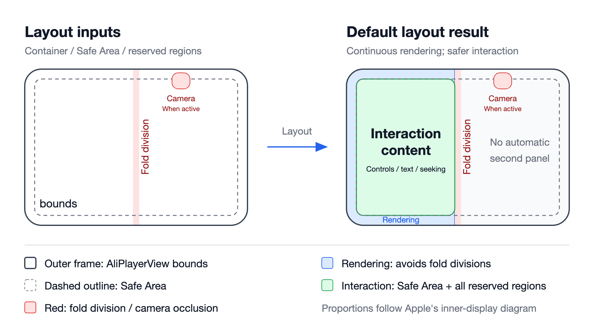
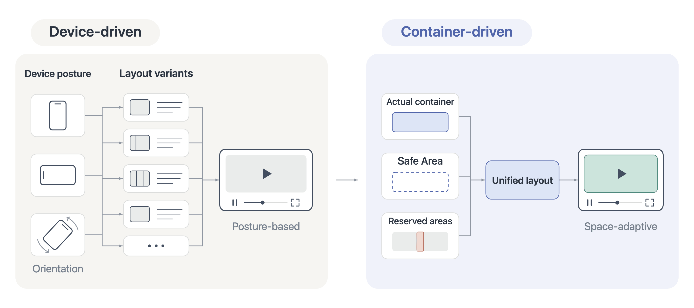
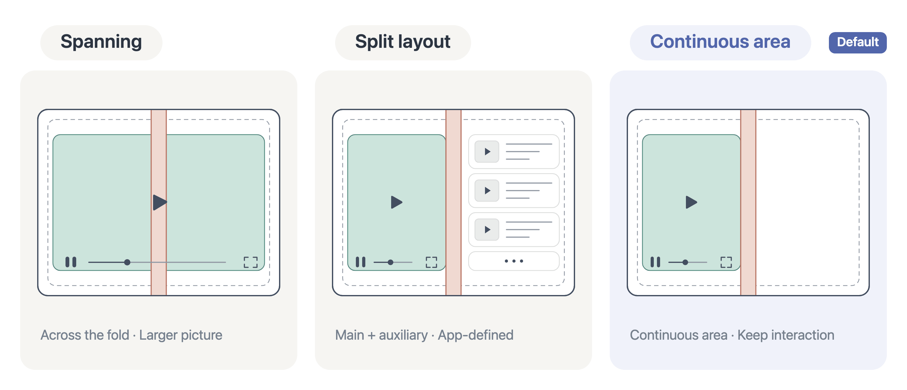
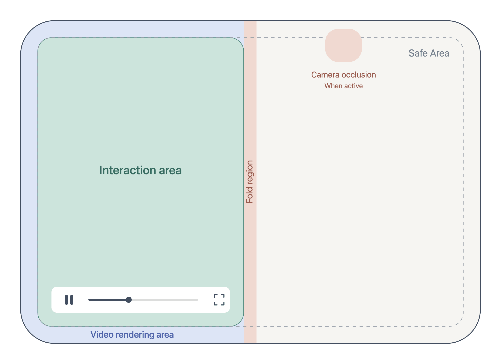
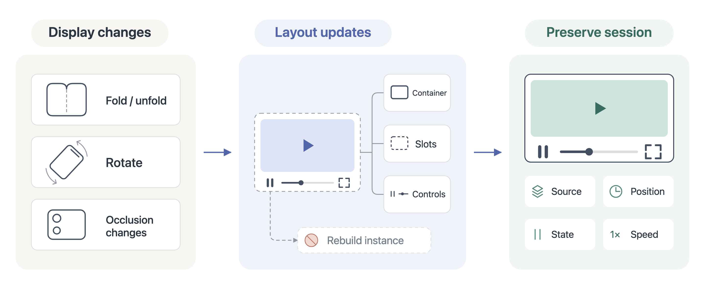

# **Best Practices for Adapting Video Players to iPhone Duo**

With iPhone Duo introducing inner and outer display switching, foldable postures, and dynamic display areas, the space available to an app changes with the device posture and window layout. The central challenge for video players is to adapt to these changes while maintaining continuity in video presentation, interaction, and playback.

Alibaba Cloud PlayerKit has completed its iPhone Duo adaptation. Its built-in UI dynamically adjusts its layout to the available display space while preserving the existing interaction experience of short-form video, long-form video, and live streaming scenarios, reducing adaptation effort for applications.

Drawing on PlayerKit's practical adaptation experience, this document covers the core principles, integration recommendations, and verification methods for adapting video players to iPhone Duo. It is intended for:

- **PlayerKit customers:** Understand the existing adaptation capabilities, upgrade PlayerKit, and adapt host containers and custom UI.
- **Player SDK customers:** Apply the relevant design principles to adapt their own player UI to foldable displays.

## **1. Why Adaptation Is Needed**

Starting in **April 2027**, Apple requires iOS apps submitted to App Store Connect to be built with the iOS 27 SDK or later, with iOS 15 as the minimum deployment target. To ensure correct presentation and interaction on iPhone Duo, developers should complete layout adaptation and compatibility verification in advance.

The core principle is to **lay out dynamically based on the actual available space, rather than adapting separately to specific device models**. According to the [Apple iPhone Duo design guidelines](https://developer.apple.com/design/human-interface-guidelines/designing-for-iphone-duo), developers should use container dimensions, Size Class, Safe Area, and system reserved regions to drive dynamic layout, rather than designing separate interfaces for different device postures.

Even after PlayerKit has been adapted, the host app still needs to check the compatibility of its page layouts and custom components to ensure that the overall experience works correctly.

## **2. PlayerKit Adaptation Support and Boundaries**

### **2.1 Responsibilities by Integration Method**

| Integration method | Provided by PlayerKit / player SDK | Application responsibilities |
| ------------------ | --------------------------------- | ---------------------------- |
| PlayerKit default UI | Automatically responds to container size changes, handles fold-region avoidance, and keeps controls clear of obstructions; layout adjustments do not affect the player instance | Host container, page layout, navigation, and fullscreen strategy |
| PlayerKit custom UI | Slot-based UI framework, centralized layout management, and layout APIs such as `contentLayoutBounds` | Layout and interaction of custom controls, subtitles, and application-specific panels |
| Player SDK only | Low-level capabilities such as decoding, rendering, and playback control | Player UI, reserved-region avoidance, fullscreen, and page state management |

The PlayerKit default UI uses different avoidance strategies for video and interactive controls, keeping controls operable while preserving as much space as possible for video presentation.

The built-in UI adjusts its layout to the available space while preserving the existing core interaction patterns of short-form video, long-form video, and live streaming. Application-specific extensions, such as comments and episode selection, remain the responsibility of the host page or custom slots, avoiding coupling application layouts to the player component.

### **2.2 Version and Environment Requirements**

| Item | Requirement and notes |
| ---- | --------------------- |
| PlayerKit | 7.19.0 or later (including the underlying player SDK) |
| Development environment | Xcode 27.1 or later, macOS Tahoe 26.6 or later |
| Build SDK | iOS 27.1 or later |
| Runtime environment | The Reserved Region API is enabled on iOS 27.1 and later; earlier systems retain conventional layout and Safe Area handling |

PlayerKit provides compile-time and runtime compatibility handling for the new APIs, so adapting to iPhone Duo does not require raising the minimum deployment target across the board. However, **successful compilation, runtime compatibility, and enabling full adaptation capabilities are different things**. Upgrading only the device OS or the underlying player SDK does not replace PlayerKit's adaptation changes.

Also, although the PlayerKit core podspec declares a minimum supported version of iOS 9.0, this does not mean that the entire project and its dependencies still support iOS 9.0 as a deployment target. The actual minimum deployment target must take into account the versions supported by Xcode and the dependencies. Refer to the [Apple Xcode system requirements](https://developer.apple.com/xcode/system-requirements/).

### **2.3 UIKit and SwiftUI: Different Technical Paths, Same Adaptation Principles**

Apple provides iPhone Duo adaptation capabilities for both UIKit and SwiftUI. Both emphasize dynamic layout based on container dimensions and system reserved regions, without requiring separate UIs for different device postures.



| Framework | Adaptation approach | PlayerKit support |
| --------- | ------------------- | ----------------- |
| UIKit | Use Auto Layout, Safe Area, and the Reserved Region API to adjust the layout dynamically based on the available space | PlayerKit is currently implemented in UIKit and centrally handles fold-region and occlusion avoidance in the slot layout layer |
| SwiftUI | Use system layout containers and `GeometryReader` to obtain container dimensions, query system reserved regions through `GeometryProxy`, and adjust the layout based on the available space | The UIKit player view can be integrated through `UIViewRepresentable`, but PlayerKit does not currently provide a native SwiftUI implementation |

The two frameworks use different implementations, but follow the same adaptation principles. Choose the approach that suits your existing technology stack; there is no need to migrate UI frameworks just to adapt to iPhone Duo.

## **3. Integration Guide for PlayerKit Customers**

### **3.1 Make the Host Container Respond to Size Changes**

The internal UI of `AliPlayerView` automatically adjusts its layout when `bounds` changes, but the host still controls the view's position and size. Choose one of the following layout approaches based on your existing project:

- **Autoresizing:** Set `UIViewAutoresizingFlexibleWidth | UIViewAutoresizingFlexibleHeight` so that the player resizes with its parent container. See [Quick Start](../QuickStart-EN.md).
- **Auto Layout:** Disable `translatesAutoresizingMaskIntoConstraints` and manage the player's size through constraints.
- **Manual layout:** Update `frame` based on the container dimensions in callbacks such as `viewDidLayoutSubviews`, rather than setting it only during initialization.

For an embedded player, use the actual container dimensions as the basis for layout rather than directly using `UIScreen.mainScreen.bounds`. Also, do not equate landscape or fullscreen with ample space: Safe Area, fold regions, and camera occlusion still need to be considered.

### **3.2 Adapt Custom Slots to the Interactive Area**

Based on the currently available space, PlayerKit selects a continuous layout region that avoids the fold region for rendering and control slots, then adjusts content layout according to each slot's avoidance strategy. The host continues to control the size of the outer `AliPlayerView`, and the actual video presentation also depends on the scale mode.

For custom UI, `BaseSlot` provides the read-only property `contentLayoutBounds`, which represents the content layout bounds after avoidance has been applied, expressed in the slot's own coordinate space. Controls and content that need to avoid system reserved regions should be laid out within these bounds.

The following example uses `frame` layout in a `BaseSlot` subclass, assuming that `controlsView` has already been created and added in `setupContentView`:

```objc
- (void)layoutSubviews {
    [super layoutSubviews];
    self.controlsView.frame = self.contentLayoutBounds;
}
```

`contentLayoutBounds` updates as the layout changes, so read it again in `layoutSubviews`; do not cache it or apply the host's Safe Area insets a second time. Backgrounds can use `bounds`, while interactive components should use `contentLayoutBounds`.

When using Auto Layout, manage the content area through constraints and avoid mixing them with direct `frame` assignments.

In addition, `safeAreaEdges` controls Safe Area avoidance for the slot's root view, while `avoidsOcclusion` controls avoidance of occlusions such as the camera. Neither affects the basic fold-region avoidance rules. For configuration details, see [Slot System](../advanced/SlotSystem-EN.md).

### **3.3 Maintain Fullscreen and Playback State Continuity**

By default, PlayerKit presents fullscreen content through a separate window within the same `UIWindowScene`. If the host already has a fullscreen container or orientation management strategy, customize the transition through `playerView.fullscreenTransition` to coordinate the player's fullscreen transitions with the host's existing layout and navigation logic.

Size changes caused by folding, rotation, and similar events require only UI layout updates. Do not call `configure:`, `detach`, or `destroy` again, and do not pause or prepare the video again solely because the size changes. This preserves continuity in playback progress, paused state, and playback speed.

Follow the existing application rules when handling UI state and temporary interactions. See Section 5.3 for details.

Page exit and foreground/background transitions continue to follow the existing lifecycle strategy. If `autoLifecycleManagement` is disabled, the host must manage playback pausing and resumption itself.

## **4. Adaptation Guide for Player SDK–Only Customers**

For customers who integrate the player SDK directly, iPhone Duo adaptation mainly concerns the player UI layer. There is no need to replace the playback engine or introduce PlayerKit, but you still need to confirm that the existing SDK is compatible with the target OS.

1. **Respond to dynamic layout.** Let the video rendering container and control layer adjust their layout as container dimensions, Safe Area, and Traits change. Avoid fixed screen dimensions or device model checks. Layout updates should not recreate the player instance.
2. **Preserve the aspect ratio.** Long-form video typically uses aspect-fit display to show the entire picture, allowing black bars. Short-form video can use aspect-fill cropping according to application requirements. Avoid stretching the picture. In PlayerKit, the corresponding modes are `ScaleModeFitCenter` and `ScaleModeCenterCrop`; when using the SDK directly, select the appropriate scale mode.
3. **Handle system reserved regions.** Prefer system adaptive layouts and Safe Area. For fold regions, cameras, and other areas that may occlude custom content, obtain reserved-region information through the Reserved Region API and update the layout when the device posture or window environment changes. Avoid hard-coding the fold position.
4. **Keep interactions reachable.** When space is limited, secondary actions can be collapsed, but retain access to them and provide appropriate touch targets. Progress bars, subtitles, comments, pop-up panels, and other components also need adaptation; adjusting only the video presentation is not enough.

UIKit customers who need fine-grained layout control can refer to [UIView Reserved Region](https://developer.apple.com/documentation/uikit/uiview/reservedregion) and query fold divisions and occlusion regions through the Objective-C API `reservedRegionsOfKind:`.

For implementation details, refer to the layout and slot adaptation in [PlayerKit-iOS](https://github.com/aliyun/PlayerKit-iOS) and the [Apple Reserved Region documentation](https://developer.apple.com/documentation/uikit/uiview/reservedregion).

## **5. Core Design and Practical Experience**

When integrating the player SDK directly, applications are mainly responsible for adapting their own player UI. As a reusable UI component, PlayerKit needs both to adapt its built-in UI and to provide a stable, reusable foundation for custom UI extensions.

This adaptation builds on the existing slot architecture. While preserving the existing UI and application behavior, it centralizes available-region calculation, fold-region avoidance, and layout updates within the framework for reuse by the default UI and custom slots that follow the layout contract. Component composition, visual styling, and application-specific interactions remain in the application layer. **The value of the slot architecture is to centralize common concerns, not to take over more application-specific UI.**

### **5.1 Dynamic Layout: From Device Posture to Available Space**

Device posture does not directly determine the player layout. In the same posture, the player may occupy different containers, such as fullscreen, a card, or a split view. Therefore, the six iPhone Duo device postures combined with portrait and landscape orientations should be included in the verification matrix, but this does not mean that separate layout logic is needed for each combination. **A better approach is to base layout on the actual container dimensions, Safe Area, and Reserved Region.**



PlayerKit implements this principle through its existing slot architecture: the host controls the outer container dimensions, `AliPlayerView` manages the internal layout, and `SlotHostLayout` centrally calculates the continuous available region. Each slot then determines its content layout bounds according to its own avoidance strategy; the application remains responsible for the internal arrangement and interactions of custom components.

It is important to distinguish between **presentation state and layout capacity**: fullscreen describes how the player is presented, but does not necessarily mean that enough space is available. For example, whether the exit-fullscreen button is shown depends on the fullscreen state, whereas the number of actions the control bar can accommodate depends on the actual available width. Even in fullscreen, the fold region may narrow the area available for controls.

Adaptive layout does not mean that every control should scale proportionally with the screen. Button sizes and component spacing can retain their existing design. The key is to avoid hard-coding screen widths or assuming that a particular orientation always provides enough space. When space is insufficient, first rearrange components or collapse secondary actions while retaining access to essential actions, rather than shrinking the entire UI until it becomes difficult to tap.

**Practical experience:** Presentation state determines what actions mean; available space determines layout capacity. When space changes, prioritize reorganizing the UI rather than designing a separate interface for every posture or scaling all controls proportionally.

### **5.2 Fold-Region Adaptation: Balancing Picture Continuity and Control Reachability**

On a foldable display, a larger display area does not automatically mean a better playback experience. The player needs to balance picture continuity when spanning the fold region, control operability, and the layout requirements of different application scenarios.



| Layout approach | Use case | Main trade-off |
| --------------- | -------- | -------------- |
| Spanning the fold region | A large picture or immersive background | Makes full use of the display space, but the fold region may affect picture continuity |
| Split-region composition | Video paired with comments, episode selection, or information | Makes full use of both sides, but requires content and interactions to be reorganized |
| Continuous-region layout (default) | Preserving the existing player UI | Prevents the fold region from dividing the picture and keeps controls operable, but may leave some space underused |

Short-form video, long-form video, and live streaming have different requirements for content composition and interaction. PlayerKit should not force a uniform layout or introduce additional application-specific panels simply because the screen unfolds. Therefore, **the default is to select the largest continuous available region that avoids the fold region, preventing it from dividing the picture while preserving existing interaction patterns**.

If the application needs to show video alongside secondary content such as comments or episode selection, the host can organize a dual-region layout and consider using UIKit's [UIArrangementViewController](https://developer.apple.com/documentation/uikit/uiarrangementviewcontroller) or SwiftUI's [ArrangementView](https://developer.apple.com/documentation/swiftui/arrangementview) to compose content across regions.



*Layout principle: the host continues to control the outer player's dimensions; the internal rendering region avoids the fold region, and the interaction region additionally avoids Safe Area and camera occlusion.*

The implementation needs to distinguish between two types of regions:

- **Rendering region:** Prioritizes video picture continuity and may extend into system occlusion regions, such as the camera area, according to application requirements. However, part of the picture in those regions may be physically obscured, and the actual presentation also depends on the video scale mode.
- **Interaction region:** Key controls, such as buttons and progress bars, must remain visible and operable, requiring additional consideration of Safe Area and camera occlusion.

UIKit's Reserved Region distinguishes fold divisions (Division) from occlusion regions (Occlusion). PlayerKit first unifies the coordinate space, uses Division to calculate a continuous available region that avoids the fold, and then combines Safe Area, Occlusion, and each slot's avoidance strategy to determine the final layout bounds.

When calculating the layout, note that the `frame` returned by Reserved Region is expressed in the current UIView's coordinate space and already includes the corresponding `margins`. Do not add them again.

Region calculation is not a one-time operation. **Reserved-region changes are not necessarily accompanied by container size changes**: for example, starting or stopping the camera may change the occlusion region while `bounds` remains unchanged. PlayerKit therefore reads Reserved Region in `updateConstraints`, using UIKit's automatic tracking to respond to changes, and recalculates the layout when the view moves between windows or Safe Area changes.

With centralized region calculation and updates, custom slots can reuse `contentLayoutBounds`, introduced in Section 3.2, without handling the underlying region calculations themselves. However, **a correctly laid-out component does not guarantee that multiple components will work reliably together**. For example, the bottom bar and subtitles may overlap, or a newly added overlay may intercept existing gestures. Custom slots therefore also need to address three aspects:

- **Spatial coordination:** Organize component layouts and view hierarchy appropriately to prevent slots from obscuring one another.
- **Event coordination:** Handle touch event routing correctly to prevent overlays from unintentionally intercepting interactions with underlying components.
- **Lifecycle coordination:** Follow the slot lifecycle contract to avoid leftover state when components are dynamically added, removed, or updated.

**Practical experience:** Centralize available-region calculation and updates, and establish clear rules for component coordination to ensure reliable layout and interaction across the player as a whole.

### **5.3 State Continuity: Decoupling Layout Changes from the Playback Lifecycle**



Folding, unfolding, or rotating the device is fundamentally a change in display space and should not trigger player reinitialization. Otherwise, even if the final layout is correct, playback may be interrupted, progress may be lost, or UI state may be reset. Adaptation therefore requires checking not only screenshots after a change, but also whether playback and interaction behave as expected throughout the transition.

PlayerKit confines layout adjustments to the UI layer, adapting to new display space by updating container and slot layouts without reconfiguring or recreating the player instance. This preserves continuity in playback state, including the playback source, progress, paused state, and playback speed. UI states, such as control bar visibility and panel state, are retained or adjusted according to the existing application logic.

**State continuity does not mean preserving every state unchanged.** Playback state should not reset because of a layout change. Temporary states, such as drag starting positions and gesture displacement, depend on the old coordinates and need to be recalculated, or the interaction must explicitly end or cancel.

For example, after the progress bar width changes, do not continue using the old width to convert gesture displacement into playback progress. After a layout change, check whether interactions such as long-press speed-up can continue; if not, end or cancel them. When the interaction ends or is cancelled, restore the playback speed according to the existing rules.

Compatibility means not only keeping public APIs unchanged, but also preserving the meaning of existing actions and their behavioral contracts. Controls may move, but the meaning of playback actions should not change; back navigation and restoration after fullscreen should continue to follow the host's existing strategies.

**Layout adaptation should not change the host's lifecycle or fullscreen management strategies.** Page exit and foreground/background transitions continue to follow the existing rules. Where navigation, orientation management, or parent view constraints are involved, the host coordinates them through a custom fullscreen transition.

**Practical experience:** The same playback session should continuously adapt to new display space. Keep playback state continuous, let UI state follow application logic, and define clear rules for continuing, ending, or cancelling temporary interactions, rather than refreshing the interface by recreating the player.

## **6. Adaptation Verification and Testing Recommendations**

**We recommend prioritizing a physical iPhone Duo for adaptation and debugging**, combining the six device postures with portrait and landscape orientations to create twelve baseline verification scenarios. In addition to checking the layout in each scenario, cover posture transitions, container resizing, and reserved-region changes to verify playback continuity and interaction stability.


| Verification item | Pass criteria |
| ----------------- | ------------- |
| Inner/outer display switching, repeated folding/unfolding, and container resizing | Correct aspect ratio, no layout misalignment or stale dimensions, and no player reinitialization caused by layout changes |
| Partial folding, camera start/stop, and Safe Area changes | Controls avoid fold regions and occlusions; the layout updates promptly when reserved regions change and can return to its previous arrangement |
| Changing device posture during progress dragging, long-press speed-up, or while a panel is shown | Gestures end or cancel correctly, no temporary state remains, and menus and actions remain accessible |
| Changing device posture while playing, paused, buffering, or after playback completes | No unexpected replay or resumption of paused video; progress, playback speed, and UI state remain consistent |
| Fullscreen transitions, page navigation, and foreground/background transitions | The player restores its layout correctly without affecting host navigation, orientation strategies, or other player instances |
| Dynamic composition of custom slots, and showing or removing overlays | No unintended overlap between components, correct touch event routing, and no leftover state after dynamic addition or removal |

Test assets should cover landscape, portrait, and non-standard aspect ratio videos, and short-form video, long-form video, and live streaming scenarios should each be verified. Add tests for custom subtitles, audio track selection, application-specific panels, and other features according to the actual integration.

> The Alibaba Cloud player SDK does not currently support running in the Simulator and does not yet provide XCFramework integration. We therefore recommend completing full player verification on a physical device. For standalone UI layouts that do not depend on the player SDK, you can also refer to Apple's [Device Hub](https://developer.apple.com/documentation/xcode/device-hub) for supplementary testing.
