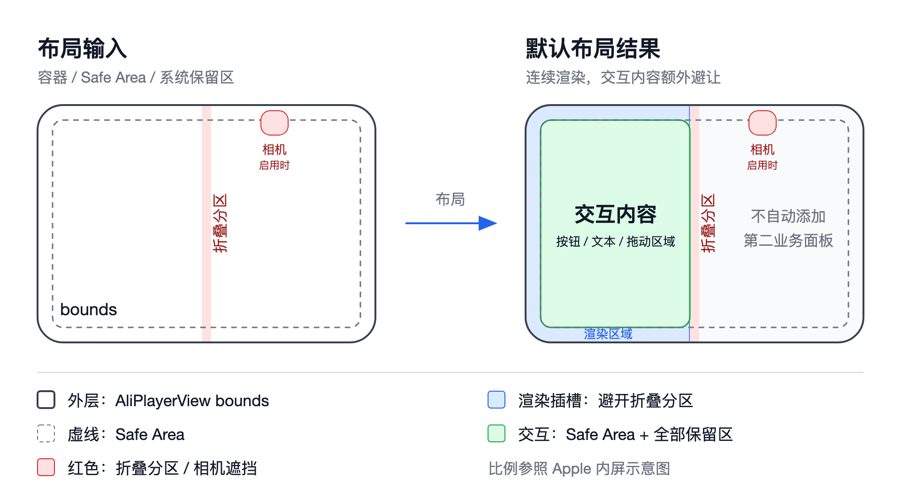
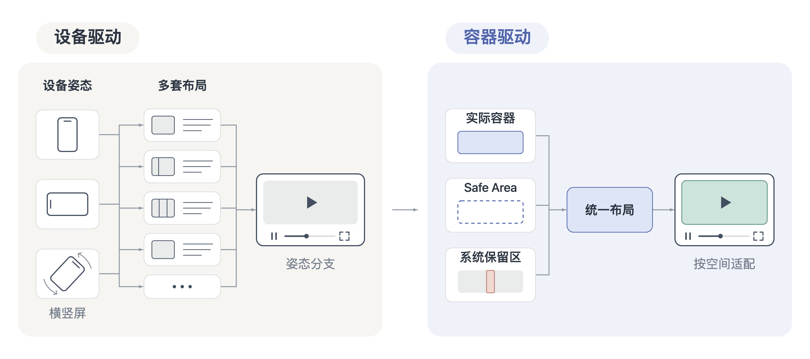
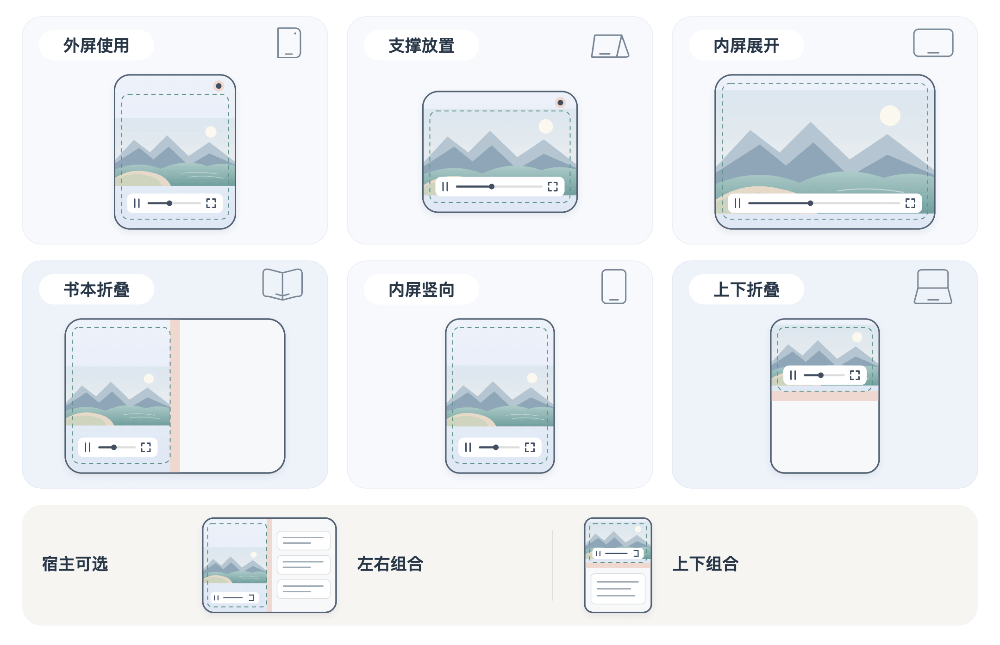
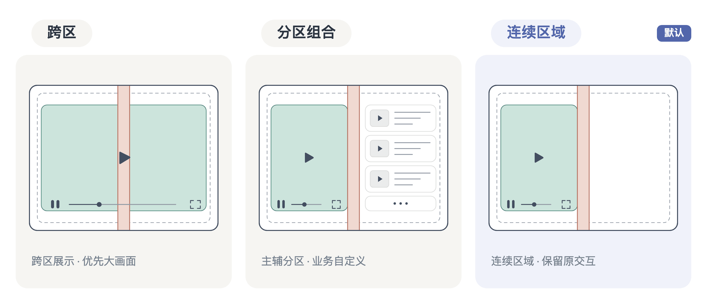
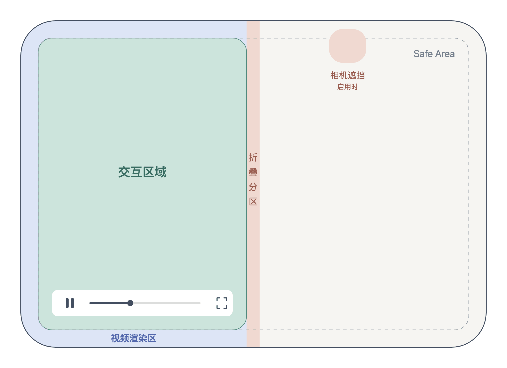
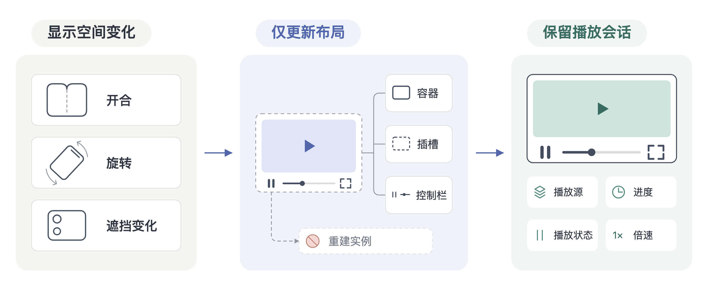

# **iPhone Duo 播放器适配最佳实践**

随着 iPhone Duo 引入内外屏切换、折叠形态及动态显示区域，应用可用空间会随设备形态和窗口布局动态变化。如何在适应不同显示空间的同时，保持画面展示、交互操作和播放过程的连续性，成为播放器适配 iPhone Duo 需要解决的核心问题。

阿里云 PlayerKit 已完成 iPhone Duo 适配，支持播放器内置 UI 根据可用显示空间动态调整布局，同时保留短视频、长视频和直播场景原有的交互体验，降低业务适配成本。

本文结合 PlayerKit 的实际适配经验，介绍播放器适配 iPhone Duo 的核心原则、接入建议及验证方法，适用于：

- **PlayerKit 客户：**了解现有适配能力，完成版本升级、宿主容器及自定义 UI 的适配。
- **播放器 SDK 客户：**参考相关设计原则，完成自建播放器 UI 的折叠屏适配。

## **1. 为什么需要适配**

自 **2027 年 4 月**起，Apple 要求提交至 App Store Connect 的 iOS 应用使用 iOS 27 SDK 或更高版本构建，最低部署版本为 iOS 15。为确保应用在 iPhone Duo 上正常显示和交互，开发者应提前完成布局适配与兼容性验证。

iPhone Duo 可在多种握持和折叠姿态下使用，应用需要适应可用显示空间的变化。


适配的核心原则是**基于实际可用空间动态布局，而非针对设备型号单独适配**。根据 [Apple iPhone Duo 设计指南](https://developer.apple.com/cn/design/human-interface-guidelines/designing-for-iphone-duo)，开发者应结合容器尺寸、Size Class、Safe Area 和系统保留区进行动态布局，而非针对不同设备姿态单独设计界面。

PlayerKit 完成适配后，宿主 App 仍需检查页面布局及自定义组件的兼容性，确保整体体验正常。

## **2. PlayerKit 的适配支持与边界**

### **2.1 按接入方式明确职责**

| 接入方式            | PlayerKit / 播放器 SDK 提供                                  | 业务方负责                                |
| ------------------- | ------------------------------------------------------------ | ----------------------------------------- |
| PlayerKit 默认 UI   | 自动响应容器尺寸变化，处理折叠区域与控件避让，布局调整不影响播放实例 | 宿主容器、页面布局、导航及全屏策略        |
| PlayerKit 自定义 UI | 插槽 UI 基础框架、统一布局管理及 `contentLayoutBounds` 等布局接口 | 自定义控件、字幕和业务面板的布局与交互    |
| 仅播放器 SDK        | 解码、渲染及播放控制等底层能力                               | 播放器 UI、保留区避让、全屏及页面状态管理 |

PlayerKit 默认 UI 对视频画面与交互控件采用不同的避让策略，在保证控件可操作性的同时，尽可能保留画面的展示空间。

内置 UI 随可用空间调整布局，但保留短视频、长视频和直播原有的核心交互方式。评论、选集等业务扩展内容仍由宿主页面或自定义插槽负责，避免将业务布局耦合到播放器组件中。

### **2.2 版本与环境要求**

| 项目      | 版本要求及说明                                               |
| --------- | ------------------------------------------------------------ |
| PlayerKit | 7.19.0 及以上（含底层播放器 SDK）                            |
| 开发环境  | Xcode 27.1 及以上，macOS Tahoe 26.6 及以上                   |
| 构建 SDK  | iOS 27.1 及以上                                              |
| 运行环境  | iOS 27.1 及以上启用 Reserved Region API，旧系统沿用常规布局及 Safe Area 处理 |

PlayerKit 对新 API 进行了编译期和运行期兼容处理，因此无需为适配 iPhone Duo 统一提高最低部署版本。但**编译通过、运行兼容与启用完整适配能力是不同的概念**，仅升级设备系统或底层播放器 SDK，并不能替代 PlayerKit 的适配改造。

此外，PlayerKit 核心 podspec 虽声明最低支持 iOS 9.0，但这不代表整个工程及其依赖仍支持以 iOS 9.0 为部署目标。实际最低部署版本还需结合 Xcode 和依赖库的支持范围确定，具体以 [Apple Xcode 版本要求](https://developer.apple.com/xcode/system-requirements/) 为准。

### **2.3 UIKit 与 SwiftUI：不同技术路径，相同适配原则**

Apple 分别为 UIKit 和 SwiftUI 提供了 iPhone Duo 适配能力，两者均强调基于容器尺寸和系统保留区进行动态布局，无需为不同设备姿态分别设计 UI。

| 技术框架 | 适配方式                                                     | PlayerKit 支持情况                                           |
| -------- | ------------------------------------------------------------ | ------------------------------------------------------------ |
| UIKit    | 使用 Auto Layout、Safe Area 和 Reserved Region API，根据可用空间动态调整布局 | PlayerKit 当前采用 UIKit 实现，在插槽布局层统一处理折叠区域及遮挡避让 |
| SwiftUI  | 使用系统布局容器和 `GeometryReader` 获取容器尺寸，通过 `GeometryProxy` 查询系统保留区，并根据可用空间调整布局 | 可通过 `UIViewRepresentable` 集成 UIKit 播放器视图，但目前不提供原生 SwiftUI 实现 |

两种框架的实现方式不同，但适配原则一致。开发者可根据现有技术栈选择对应方案，无需为了适配 iPhone Duo 而迁移 UI 框架。

## **3. PlayerKit 客户如何接入**

### **3.1 让宿主容器响应尺寸变化**

`AliPlayerView` 内部 UI 会随 `bounds` 自动调整布局，但其位置和尺寸仍由宿主控制。开发者可根据现有工程选择以下布局方式：

- **Autoresizing：**设置 `UIViewAutoresizingFlexibleWidth | UIViewAutoresizingFlexibleHeight`，使播放器随父容器调整尺寸，参见[快速开始](../QuickStart.md)。
- **Auto Layout：**关闭 `translatesAutoresizingMaskIntoConstraints`，通过约束管理播放器尺寸。
- **手动布局：**在 `viewDidLayoutSubviews` 等回调中，根据容器尺寸更新 `frame`，避免仅在初始化时设置。

对于嵌入式播放器，应以实际容器尺寸为布局依据，而非直接使用 `UIScreen.mainScreen.bounds`。同时，不应将横屏或全屏等同于空间充足，仍需考虑 Safe Area、折叠区域及摄像头遮挡。

### **3.2 自定义插槽适配可交互区域**

PlayerKit 会根据当前可用空间，为渲染和控制插槽选择避开折叠区域的连续布局区域，并结合各插槽的避让策略调整内容布局。外层 `AliPlayerView` 的尺寸保持由宿主控制，实际视频画面还取决于缩放模式。



对于自定义 UI，`BaseSlot` 提供只读属性 `contentLayoutBounds`，表示经过避让处理后的内容布局范围，使用插槽自身的坐标系。需要避开系统保留区的控件和内容，应在该范围内布局。

以下为 `BaseSlot` 子类中使用 `frame` 布局的示例，假设 `controlsView` 已在 `setupContentView` 中创建并添加：

```objc
- (void)layoutSubviews {
    [super layoutSubviews];
    self.controlsView.frame = self.contentLayoutBounds;
}
```

`contentLayoutBounds` 会随布局变化更新，应在 `layoutSubviews` 中重新读取，不要缓存或重复叠加宿主的 Safe Area Insets。背景可使用 `bounds`，交互组件则应使用 `contentLayoutBounds`。

采用 Auto Layout 时，应通过约束管理内容区域，避免与直接设置 `frame` 混用。

此外，`safeAreaEdges` 用于控制插槽根视图的安全区避让，`avoidsOcclusion` 用于控制摄像头等遮挡避让。两者均不影响折叠区域的基础避让规则。具体配置参见[插槽系统](../advanced/SlotSystem.md)。

### **3.3 保持全屏与播放状态的连续性**

PlayerKit 默认通过同一 `UIWindowScene` 内的独立窗口实现全屏展示。若宿主已有全屏容器或方向管理策略，可通过 `playerView.fullscreenTransition` 自定义过渡，协调播放器全屏切换与宿主现有布局及导航逻辑。

设备折叠、旋转等引起的尺寸变化仅需更新 UI 布局，不应重新调用 `configure:`、`detach` 或 `destroy`，也不应仅因尺寸变化而暂停或重新准备视频，以保持播放进度、暂停状态及倍速的连续性。

UI 状态与临时交互的处理应遵循原有业务规则，详见第 5.3 节。

页面退出及前后台切换仍遵循原有生命周期策略。若关闭 `autoLifecycleManagement`，则需由宿主自行管理播放暂停与恢复。

## **4. 仅使用播放器 SDK 的客户如何适配**

对于直接集成播放器 SDK 的客户，iPhone Duo 适配主要集中在播放器 UI 层，无需更换播放内核或引入 PlayerKit，但仍需确认现有 SDK 与目标系统的兼容性。

1. **响应动态布局。**让视频渲染容器和控制层随容器尺寸、Safe Area 及 Traits 变化调整布局，避免使用固定屏幕尺寸或设备型号判断。布局更新不应导致播放器实例重建。
2. **保持画面比例。**长视频通常采用等比完整显示，允许留黑边；短视频可根据业务需求选择等比裁剪，避免直接拉伸画面。PlayerKit 对应 `ScaleModeFitCenter` 和 `ScaleModeCenterCrop`，直接使用 SDK 时可选择相应的缩放模式。
3. **处理系统保留区。**优先使用系统自适应布局和 Safe Area。对于折叠区域、摄像头等可能遮挡自定义内容的场景，可通过 Reserved Region API 获取保留区信息，并在设备形态或窗口环境变化时更新布局，避免硬编码折叠位置。
4. **保证交互可达。**空间不足时可收起次要操作，但应保留操作入口及合理的触控区域。进度条、字幕、评论和弹出面板等组件也需要适配，不能只调整视频画面。

对于需要精细控制布局的 UIKit 客户，可参考 [UIView Reserved Region](https://developer.apple.com/documentation/uikit/uiview/reservedregion)，通过 Objective-C 接口 `reservedRegionsOfKind:` 查询折叠分区和遮挡区域。

具体实现可参考 [PlayerKit-iOS](https://github.com/aliyun/PlayerKit-iOS) 中的布局与插槽适配方案，以及 [Apple Reserved Region 官方文档](https://developer.apple.com/documentation/uikit/uiview/reservedregion)。

## **5. 核心设计与实践经验**

直接集成播放器 SDK 时，业务方主要负责自建播放器 UI 的适配；PlayerKit 作为可复用的 UI 组件，既要适配内置 UI，也要为上层扩展 UI 提供稳定、可复用的适配基础。

本次改造沿用既有插槽架构，在保留现有 UI 和业务行为的前提下，将可用区域计算、折叠区避让和布局更新集中到框架中，供默认 UI 和遵循布局契约的自定义插槽复用。组件如何组合、采用什么视觉样式、提供哪些业务交互，仍由上层决定。**插槽架构的价值，是集中解决共性问题，而不是接管更多业务 UI。**

### **5.1 动态布局：从设备姿态到可用空间**

设备姿态并不能直接决定播放器的布局。同一姿态下，播放器可能处于全屏、卡片或分栏等不同容器中。因此，iPhone Duo 的六种设备形态及横竖屏组合应纳入验证矩阵，但不意味着需要分别实现布局逻辑。**更合理的方式是以实际容器尺寸、Safe Area 和 Reserved Region 作为布局依据。**



这一原则通过 PlayerKit 既有的插槽架构落地：宿主控制外层容器尺寸，`AliPlayerView` 管理内部布局，`SlotHostLayout` 统一计算连续可用区域。各插槽再结合自身的避让策略确定内容布局范围；自定义组件内部的排列和交互仍由业务负责。

这里需要区分**呈现状态与布局容量**：全屏表示播放器的呈现方式，并不意味着空间一定充足。例如，退出全屏按钮是否显示取决于全屏状态，而控制栏能够容纳多少操作取决于实际可用宽度。即使同为全屏，折叠区域也可能让控制区域变窄。

自适应也不意味着所有控件都要随屏幕同比缩放。按钮尺寸和组件间距可以保留原有设计，重点是避免写死屏幕宽度，或假定某个方向下始终有充足空间。当可用空间不足时，应优先调整组件排列或收起次要操作，同时保留必要的操作入口，而不是把整套 UI 缩小到难以点击。

下图以同一段 16:9 视频的等比完整显示为例，展示不同可用空间下的播放器布局。主辅内容组合由宿主选择，并非默认 UI 自动切换的结果。



*布局原理示意，非真机截图。蓝色为渲染容器，绿色虚线为控件安全布局范围；实际布局以系统保留区与当前可用空间为准。*

**实践经验：**呈现状态决定操作含义，可用空间决定布局容量。空间变化时，优先调整 UI 的组织方式，而不是为每种姿态设计界面，或把所有控件同比缩小。

### **5.2 折叠区适配：画面连续性与控制可达性的取舍**

折叠屏并非显示面积越大，播放体验就越好。播放器需要兼顾画面跨越折叠区时的连续性、控制组件的可操作性，以及不同业务场景的布局需求。



| 布局方案             | 适用场景                   | 主要取舍                                         |
| -------------------- | -------------------------- | ------------------------------------------------ |
| 跨折叠区展示         | 大画面或沉浸式背景         | 充分利用显示空间，但折叠区可能影响画面连续性     |
| 分区组合             | 视频搭配评论、选集或信息区 | 充分利用两侧空间，但需要重新组织内容与交互       |
| 连续区域布局（默认） | 保持现有播放器 UI          | 避免画面被折叠区分割，保持控件可操作，但部分空间可能未充分利用 |

短视频、长视频和直播对内容组合与交互的需求不同，PlayerKit 不应因屏幕展开而强制统一布局或加入额外业务面板。因此，**默认选择避开折叠区的最大连续可用区域，避免画面被折叠区分割，并保留原有交互方式**。

若业务需要同时展示视频与评论、选集等主辅内容，可由宿主组织双区域布局，并考虑使用 UIKit 的 [UIArrangementViewController](https://developer.apple.com/documentation/uikit/uiarrangementviewcontroller) 或 SwiftUI 的 [ArrangementView](https://developer.apple.com/documentation/swiftui/arrangementview) 实现跨区域组合。

在默认布局中，渲染区域与控件布局范围采用不同的避让策略：



*布局原理示意：蓝色为渲染容器，控件叠加在其中；实际视频画面的范围由缩放模式决定。*

- **渲染区域：**优先保证视频画面的连续性，可根据业务需求延伸至摄像头等系统遮挡区域，但该区域的部分画面可能被物理遮挡，实际显示效果还取决于视频缩放模式。
- **交互区域：**按钮、进度条等关键控件必须保持可见、可操作，需要额外考虑 Safe Area 和摄像头遮挡。

UIKit 的 Reserved Region 可区分折叠分区（Division）和遮挡区域（Occlusion）。PlayerKit 先统一坐标系，根据 Division 计算避开折叠区的连续可用区域，再结合 Safe Area、Occlusion 和各插槽的避让策略确定最终布局范围。

计算时需要注意：Reserved Region 返回的 `frame` 位于当前 UIView 的坐标系中，且已包含对应的 `margins`，无需再次叠加。

区域计算也不是一次性的。**保留区变化不一定伴随容器尺寸变化**：例如，摄像头启停可能改变遮挡区域，但 `bounds` 保持不变。为此，PlayerKit 在 `updateConstraints` 中读取 Reserved Region，利用 UIKit 的自动跟踪机制响应变化，并在窗口迁移或 Safe Area 更新时重新计算布局。

有了统一的区域计算和更新机制，自定义插槽可以复用第 3.2 节介绍的 `contentLayoutBounds`，无需自行处理底层区域计算。但**单个组件布局正确，不代表多个组件组合后就能可靠协作**。例如，底栏与字幕可能发生重叠，新增浮层也可能拦截原有手势。因此，自定义插槽还需要关注三个方面：

- **空间协同：**合理组织组件布局和视图层级，避免不同插槽之间相互遮挡。
- **事件协同：**正确处理触摸事件分发，避免浮层意外拦截底层组件的交互。
- **生命周期协同：**遵循插槽生命周期约定，避免组件动态添加、移除或更新后产生状态残留。

**实践经验：**统一可用区域的计算与更新，并通过明确的组件协作规则，保证播放器整体布局与交互的可靠性。

### **5.3 状态连续性：布局变化与播放生命周期解耦**

设备折叠、展开或旋转，本质上是显示空间的变化，不应触发播放器重新初始化。否则，即使最终布局正常，也可能出现播放中断、进度丢失或 UI 状态重置等问题。因此，适配不能只检查变化后的截图，还要检查变化过程中播放和交互是否符合预期。



PlayerKit 将布局调整限制在 UI 层，通过更新容器和插槽布局适应新的显示空间，不重新配置或重建播放实例，从而保持播放源、进度、暂停状态及倍速等播放状态的连续性。控制栏显隐、面板状态等 UI 状态，则根据原有业务逻辑决定是否保留或调整。

**状态连续性并不意味着所有状态都原样保留。**播放状态不应因布局变化而重置；拖动起点、手势位移等临时状态则依赖旧坐标，需要重新计算，或明确结束、取消交互。例如，进度条宽度变化后，不应继续用旧宽度将手势位移换算为播放进度。布局变化后，长按倍速等交互应判断能否继续；不能继续时，应结束或取消。交互结束或取消时，按原有规则恢复倍速。

兼容性不仅是公共 API 不变，也包括既有操作含义和行为约定不变。控件位置可以调整，但播放操作的含义不应改变；返回导航和全屏恢复仍应遵循宿主原有策略。

**布局适配不应改变宿主的生命周期和全屏管理策略。**页面退出、前后台切换继续按既有规则处理；涉及导航、方向管理或父视图约束时，由宿主通过自定义全屏过渡协调。

**实践经验：**同一个播放会话应持续适应新的显示空间。播放状态保持连续，UI 状态遵循业务逻辑，临时交互有明确的继续、结束与取消规则，而不是通过重建播放器来刷新界面。

## **6. 适配验证与测试建议**

**建议优先使用 iPhone Duo 真机进行适配与调试**，将六种设备姿态与横竖屏组合为十二种基础验证场景。除检查各场景下的布局，还应覆盖姿态切换、容器缩放和保留区变化过程，验证播放连续性与交互稳定性。

| 验证项                                     | 通过标准                                                     |
| ------------------------------------------ | ------------------------------------------------------------ |
| 内外屏切换、连续开合及容器缩放             | 画面比例正常，无布局错位或旧尺寸残留，播放器不因布局变化重新初始化 |
| 部分折叠、摄像头启停及 Safe Area 变化      | 控制组件避开折叠区和遮挡，保留区变化时布局及时更新并可恢复   |
| 进度拖动、长按倍速及面板显示时改变设备形态 | 手势正常结束或取消，无临时状态残留，菜单及操作入口保持可用   |
| 播放、暂停、缓冲及播放完成时切换设备形态   | 不意外重新播放或恢复已暂停的视频，进度、倍速及 UI 状态保持一致 |
| 全屏切换、页面导航及前后台切换             | 播放器正确恢复布局，不影响宿主导航、方向策略及其他播放器实例 |
| 自定义插槽动态组合、浮层显示与移除         | 组件之间无意外遮挡，触摸事件正常分发，动态添加或移除后无状态残留 |

测试素材应覆盖横向、纵向及非标准比例视频，并分别验证短视频、长视频和直播场景。自定义字幕、音轨选择及业务面板等功能，可根据实际集成情况补充测试。

> 当前阿里云播放器 SDK 不支持模拟器运行，且暂未提供 XCFramework 集成，因此建议使用真机完成播放器的完整验证。对于不依赖播放器 SDK 的独立 UI 布局，也可参考 Apple 的 [Device Hub](https://developer.apple.com/cn/documentation/xcode/device-hub) 进行辅助测试。
